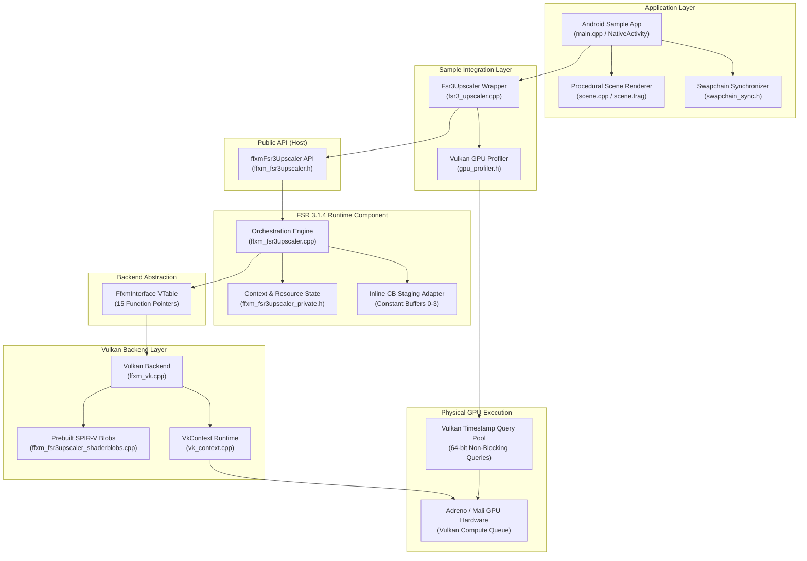

<!-- Copyright © 2024-2026 Arm Limited.
Copyright © 2024 Advanced Micro Devices, Inc.
SPDX-License-Identifier: MIT -->

# Better FSR3 Android

**Production-grade AMD FidelityFX™ Super Resolution (FSR) 3.1.4 upscaling for Android via Vulkan, built upon Arm ASR's lightweight, mobile-first runtime architecture.**

[](LICENSES/MIT.txt)
[](https://www.vulkan.org/)
[-green.svg)](https://developer.android.com/ndk)
[](#vulkan-hardware-and-driver-requirements)
[](#physical-hardware-benchmarks)

> **Project Notice**: This is an open-source engineering research project bringing AMD's FSR 3.1.4 temporal upscaler to mobile Vulkan by adapting the mobile backend architecture established in [Arm ASR (Accuracy Super Resolution)](https://github.com/arm/accuracy-super-resolution-generic-library). This project is **not affiliated with, endorsed by, or supported by Arm Limited, Advanced Micro Devices, Inc. (AMD), or Qualcomm Technologies, Inc.** All trademarks belong to their respective owners. See [Attribution and Licensing](#attribution-and-licensing).

---

## Table of Contents

- [Overview](#overview)
  - [What is FSR 3.1.4?](#what-is-fsr-314)
  - [What This Repository Implements](#what-this-repository-implements)
  - [What is Out of Scope](#what-is-out-of-scope)
- [Feature and Implementation Status](#feature-and-implementation-status)
  - [The Seven FSR 3.1.4 Compute Passes](#the-seven-fsr-314-compute-passes)
  - [Clear Operations](#clear-operations)
  - [Resource Lifecycle and Temporal History](#resource-lifecycle-and-temporal-history)
  - [16-Bit SPIR-V Shader Packaging](#16-bit-spir-v-shader-packaging)
  - [Camera Jitter and Motion Vectors](#camera-jitter-and-motion-vectors)
- [Architecture Overview](#architecture-overview)
  - [System Architecture Diagram](#system-architecture-diagram)
  - [Repository Directory Structure](#repository-directory-structure)
- [Physical Hardware Benchmarks](#physical-hardware-benchmarks)
  - [Controlled Benchmark Configuration](#controlled-benchmark-configuration)
  - [Controlled Comparison Matrix](#controlled-comparison-matrix)
  - [Key Performance Findings](#key-performance-findings)
  - [Reconciliation with Historical Baseline](#reconciliation-with-historical-baseline)
- [Profiling and Engineering Methodology](#profiling-and-engineering-methodology)
  - [Vulkan GPU Timestamp Profiling](#vulkan-gpu-timestamp-profiling)
  - [Profiler Hardening and Query Invariants](#profiler-hardening-and-query-invariants)
  - [Observed Telemetry Anomalies (POCO F6 Preemption)](#observed-telemetry-anomalies-poco-f6-preemption)
- [Building and Installation](#building-and-installation)
  - [Prerequisites](#prerequisites)
  - [Vulkan Hardware and Driver Requirements](#vulkan-hardware-and-driver-requirements)
  - [Building the Android Sample APK](#building-the-android-sample-apk)
  - [Installing and Launching on Device](#installing-and-launching-on-device)
  - [Running GPU Profiling Runs via ADB](#running-gpu-profiling-runs-via-adb)
  - [Building Static Libraries via CMake](#building-static-libraries-via-cmake)
  - [Host Testing and Validation (MSVC)](#host-testing-and-validation-msvc)
- [Development Principles](#development-principles)
- [Roadmap](#roadmap)
- [Attribution and Licensing](#attribution-and-licensing)

---

## Overview

### What is FSR 3.1.4?

**AMD FidelityFX™ Super Resolution 3.1.4 (FSR 3.1.4)** is AMD's latest temporal upscaling technology. It reconstructs sharp, high-resolution output frames from lower-resolution render targets using:
- **Temporal Accumulation**: Combining color information across consecutive frames using motion vector re-projection.
- **Luminance and Shading Change Detection**: Discerning lighting changes and material specular variations from moving geometry to eliminate ghosting.
- **Luminance Instability Detection**: Identifying temporal flickering and sub-pixel edge ringing.
- **Lanczos Sampling & History Clamping**: Preserving edge contrast while preventing disocclusion smear.

### What This Repository Implements

This repository ports the **FSR 3.1.4 Upscaler core** into the mobile-optimized, single-file Vulkan backend and clean runtime architecture pioneered by **Arm ASR**:
- **Mobile Vulkan Runtime**: Full C/C++ host implementation of the FSR 3.1.4 upscaler (`src/components/fsr3upscaler/`), decoupled from heavyweight desktop frameworks.
- **Lean Vulkan Backend (`src/backends/vk/ffxm_vk.cpp`)**: A standalone, ~3.6k-line Vulkan backend executing through a 15-callback vtable (`FfxmInterface`).
- **Explicit 16-Bit Half-Precision Shaders**: Prebuilt SPIR-V binaries compiled with explicit 16-bit floating point arithmetic (`-enable-16bit-types -DFFXM_HALF=1`) to exploit mobile GPU FP16 ALUs, lower memory traffic, and reduce thermal load.
- **Hardened GPU Timestamp Profiler (`samples/common/gpu_profiler.h`)**: Non-blocking Vulkan timestamp profiling providing microsecond-accurate per-pass hardware execution telemetry.
- **Android NativeActivity Validation Sample (`samples/android/`)**: Complete testbed rendering a procedural infinite-checkerboard ray-traced scene, generating ground-truth motion vectors and depth, and presenting 2× upscaled frames via Vulkan swapchain.

### What is Out of Scope

To prevent misunderstanding of the current codebase:
- **No Frame Generation / Optical Flow**: This project implements the **temporal upscaler component** of FSR 3.1.4. Frame Generation (Optical Flow vector calculation and frame interpolation swapchain proxying) is not implemented.
- **Not a Game Mod / Hook**: This is an engine-level SDK and validation sample. It is not an arbitrary OpenGL ES or Vulkan injection layer for commercial Android APKs.

---

## Feature and Implementation Status

### The Seven FSR 3.1.4 Compute Passes

The FSR 3.1.4 temporal upscaling pipeline is composed of seven sequential compute passes dispatched each frame:

```
+----------------------------------------------------------------------------------------------------+
|                                    FSR 3.1.4 COMPUTE PIPELINE                                      |
+----------------------------------------------------------------------------------------------------+
  [Input Depth]       [Input Motion Vectors]      [Input Color (1200x540)]
        |                       |                            |
        +------------+----------+                            |
                     |                                       |
                     v                                       v
         +-----------------------+               +-----------------------+
         |     PrepareInputs     |               |      LumaPyramid      |
         | (Recon Depth, Dilate) |               |  (SPD 5-Level Mips)   |
         +-----------------------+               +-----------------------+
                     |                                       |
                     +-------------------+-------------------+
                                         |
                                         v
                         +-------------------------------+
                         |     ShadingChangePyramid      |
                         |      (SPD Diff Mip Chain)     |
                         +-------------------------------+
                                         |
                                         v
                         +-------------------------------+
                         |         ShadingChange         |
                         |  (Pixel-Level Light Tracking) |
                         +-------------------------------+
                                         |
                                         v
                         +-------------------------------+
                         |       PrepareReactivity       |
                         | (Transparency / Ghost Masking)|
                         +-------------------------------+
                                         |
                                         v
                         +-------------------------------+
                         |        LumaInstability        |
                         |    (Flicker / Ringing Damp)   |
                         +-------------------------------+
                                         |
                                         v
                         +-------------------------------+
                         |          Accumulate           |
                         | (Lanczos Reconstruction / LUT)|
                         +-------------------------------+
                                         |
                                         v
                             [Upscaled Output (2400x1080)]
```

1. **`PrepareInputs`** ([`src/components/fsr3upscaler/ffxm_fsr3upscaler.cpp`](src/components/fsr3upscaler/ffxm_fsr3upscaler.cpp#L845-L870)):
   Prepares raw engine inputs for temporal processing. Reconstructs previous nearest depth from current depth and motion vectors, and performs 3×3 dilation on motion vectors and depth to ensure foreground edges take precedence during disocclusion.
2. **`LumaPyramid`** ([`ffxm_fsr3upscaler.cpp`](src/components/fsr3upscaler/ffxm_fsr3upscaler.cpp#L872-L897)):
   Computes current-frame color luminance and uses AMD's Single Pass Downsampler (SPD) to generate a 5-level mipmap pyramid in a single dispatch pass.
3. **`ShadingChangePyramid`** ([`ffxm_fsr3upscaler.cpp`](src/components/fsr3upscaler/ffxm_fsr3upscaler.cpp#L899-L924)):
   Generates a downsampled pyramid of luminance variance between previous history and current frame across multiple spatial scales to detect illumination changes.
4. **`ShadingChange`** ([`ffxm_fsr3upscaler.cpp`](src/components/fsr3upscaler/ffxm_fsr3upscaler.cpp#L926-L948)):
   Evaluates shading change confidence per pixel, distinguishing moving geometric edges from dynamic lighting and shadowing shifts.
5. **`PrepareReactivity`** ([`ffxm_fsr3upscaler.cpp`](src/components/fsr3upscaler/ffxm_fsr3upscaler.cpp#L950-L974)):
   Calculates accumulation reactivity weights and dilates transparency/reactive masks to protect alpha-blended particles and translucent surfaces from ghosting artifacts.
6. **`LumaInstability`** ([`ffxm_fsr3upscaler.cpp`](src/components/fsr3upscaler/ffxm_fsr3upscaler.cpp#L976-L1000)):
   Measures temporal instability in luminance changes to suppress disocclusion latency and ringing on high-contrast sub-pixel edges.
7. **`Accumulate`** ([`ffxm_fsr3upscaler.cpp`](src/components/fsr3upscaler/ffxm_fsr3upscaler.cpp#L1002-L1031)):
   The core upscaling kernel, consuming **70.7% to 73.3%** of total upscaler GPU time. Applies a Lanczos spatial reconstruction filter (optionally accelerated with precomputed weights via `useLut: true`), rect clipping, temporal history clamping, and bicubic sampling to generate the final 2400×1080 image.

### Clear Operations

Four lightweight clear operations are orchestrated between dispatches to maintain atomic counters and mip targets:
- `ClearReconstructedDepth`: Clears nearest reconstructed depth buffer prior to input preparation.
- `ClearSpdAtomicCounterInitial`: Resets the 32-bit atomic counter for the luminance SPD pass.
- `ClearSpdMips`: Clears intermediate luminance SPD mip storage.
- `ClearSpdAtomicCounterSecondary`: Resets the atomic counter for the shading change SPD pass.

### Resource Lifecycle and Temporal History

The FSR 3.1.4 context manages **19 internal surfaces** and allocates **3 shared resources** designed to be consumed by downstream frame generation pipelines:
- `dilatedDepth` (`1200x540`, `VK_FORMAT_R32_SFLOAT`)
- `dilatedMotionVectors` (`1200x540`, `VK_FORMAT_R16G16_SFLOAT`)
- `reconstructedPrevNearestDepth` (`1200x540`, `VK_FORMAT_R32_UINT`)

All temporal ping-pong buffers (`accumulation`, `internalUpscaledColor`, `lumaHistory`) are maintained internally and transitioned across states transactionally with full double-destruction and out-of-memory rollback safety.

### 16-Bit SPIR-V Shader Packaging

- Shaders are precompiled to **SPIR-V 1.4** with explicit 16-bit storage and half-precision math (`-enable-16bit-types -DFFXM_HALF=1`).
- Permutation selection is baked into dedicated C++ header blobs (`src/backends/shared/blob_accessors/prebuilt_shaders/`).
- The current Accumulate pass runs pipeline permutation `0x00000085` (`useLut: true`, 8 SRV bindings) to utilize precomputed Lanczos weight textures.
- Building on non-Windows platforms does not require Windows PE shader compiler binaries (`FidelityFX_SC.exe`); the runtime directly embeds byte-identical prebuilt SPIR-V blobs.

### Camera Jitter and Motion Vectors

- **Sub-Pixel Jitter**: Driven by a 32-phase Halton(2, 3) sequence calculated via [`ffxmFsr3UpscalerGetJitterOffset`](include/host/ffxm_fsr3upscaler.h#L518). Jitter is applied to the camera projection matrix in render-resolution pixel space.
- **Motion Vectors**: Emitted in render-resolution pixel coordinates. `motionVectorScale` is configured as `{1.0f, 1.0f}`, and depth coordinates use reverse-Z floating-point representations (`[1.0 .. 0.0]`).

---

## Architecture Overview

### System Architecture Diagram



### Repository Directory Structure

| Directory | Responsibility |
|---|---|
| [`include/host/`](include/host/) | Public host C/C++ API (`ffxm_fsr3upscaler.h`, `ffxm_interface.h`, `ffxm_types.h`, `ffxm_gpu_timestamps.h`) |
| [`include/gpu/`](include/gpu/) | Dual-use CPU/GPU definitions (`ffxm_fsr3upscaler_resources.h`, `ffxm_core_gpu_common.h`) |
| [`src/components/fsr3upscaler/`](src/components/fsr3upscaler/) | Core FSR 3.1.4 runtime, context state machine, constant buffer staging, and pass dispatch |
| [`src/backends/vk/`](src/backends/vk/) | Lean, standalone Vulkan backend implementing `FfxmInterface` (`ffxm_vk.cpp`) |
| [`src/backends/vk/shaders/fsr3upscaler/`](src/backends/vk/shaders/fsr3upscaler/) | GLSL compute shader entry points for all 7 passes and utilities |
| [`src/backends/shared/blob_accessors/`](src/backends/shared/blob_accessors/) | Prebuilt SPIR-V blob accessors and permutation arrays |
| [`samples/common/`](samples/common/) | Reusable sample code: `fsr3_upscaler.*`, `gpu_profiler.h`, `scene.*`, `swapchain_sync.h` |
| [`samples/android/`](samples/android/) | Android NativeActivity Gradle project and Android-specific Vulkan context (`vk_context.*`) |
| [`samples/windows/`](samples/windows/) | Win32 x64 MSVC standalone sample application |
| [`tests/`](tests/) | Comprehensive unit and regression test suite (`test_milestone2.cpp`, 11,846 assertions) |
| [`tools/`](tools/) | Automated physical benchmark runners, anomaly analyzers, and shader compilation utilities |
| [`artifacts/`](artifacts/) | Raw physical GPU telemetry datasets, CSVs, JSON summaries, and comparative reports |

---

## Physical Hardware Benchmarks

### Controlled Benchmark Configuration

Performance was evaluated using identical binary artifacts across two physical Android devices:
- **Workload**: FSR 3.1.4 upscaling from **1200 × 540** (Render) to **2400 × 1080** (Display) at **2.00× ratio**.
- **Shader Permutation**: `0x00000085` (`useLut: true`, 8 SRV textures).
- **Binary Identity**: Byte-identical APK (`SHA-256: 905ce086f4115c9c3c037add49da29b1503a2d4ae6519b800aecfadba6bc5b14`).
- **Telemetry Protocol**: 3 independent runs per device; 200 warmup frames discarded; exactly 500 measured frames collected per run (**1,500 total measured frames per device**).
- **Measurement Tool**: Non-blocking Vulkan GPU timestamp queries (`vkGetQueryPoolResults`).

| Parameter | Xiaomi Mi 11X | POCO F6 |
|---|---|---|
| **SoC** | Qualcomm Snapdragon 870 (`SM8250`) | Qualcomm Snapdragon 8s Gen 3 (`SM8635`) |
| **GPU Hardware** | Qualcomm Adreno (TM) 650 | Qualcomm Adreno (TM) 735 |
| **Clock Frequency** | 670 MHz (Sustained active) | Dynamic DVFS (Active) |
| **Vulkan API** | 1.1.295 | 1.3.128 |
| **Vulkan Driver** | `0.512.530` | `0.762.1` |
| **Android Version** | Android 17 (API 37) | Android 16 (API 36) |
| **Timestamp Period** | 52.0833 ns/tick (48 valid bits) | 52.0833 ns/tick (48 valid bits) |
| **Thermal State** | Status 0 (Normal, 34.7°C -> 35.2°C) | Status 0 (Normal, 37.1°C -> 37.8°C) |

> **Measurement Context**: These figures represent isolated **GPU compute execution durations** of the FSR 3.1.4 upscaler passes as recorded by hardware timestamp counters. They do not represent end-to-end game framerates, which include game simulation, raster scene rendering, CPU dispatch, and display composition. The comparison is controlled for binary and workload, but reflects differing Android OS versions and GPU driver baselines.

### Controlled Comparison Matrix

The table below summarizes median GPU execution latencies aggregated across 1,500 physical frames per device. Full raw datasets are available in [`artifacts/gpu-profiling/controlled-comparison/`](artifacts/gpu-profiling/controlled-comparison/):

| Stage / Operation | Type | Mi 11X (Adreno 650)<br>Median ms | POCO F6 (Adreno 735)<br>Median ms | Speedup % | Speedup Ratio | Mi 11X % Total | POCO F6 % Total |
|---|---|---|---|---|---|---|---|
| **TOTAL FSR 3.1.4 GPU TIME** | **Total** | **19.2500** | **8.5851** | **55.40%** | **2.24x** | **100.00%** | **100.00%** |
| `PrepareInputs` | Compute Pass | 2.1998 | 1.0121 | 53.99% | 2.17x | 11.43% | 11.79% |
| `LumaPyramid` | Compute Pass | 0.2740 | 0.1569 | 42.74% | 1.75x | 1.42% | 1.83% |
| `ShadingChangePyramid` | Compute Pass | 0.7132 | 0.3834 | 46.24% | 1.86x | 3.70% | 4.47% |
| `ShadingChange` | Compute Pass | 0.0602 | 0.0466 | 22.59% | 1.29x | 0.31% | 0.54% |
| `PrepareReactivity` | Compute Pass | 1.1199 | 0.6040 | 46.07% | 1.85x | 5.82% | 7.04% |
| `LumaInstability` | Compute Pass | 0.6164 | 0.2693 | 56.31% | 2.29x | 3.20% | 3.14% |
| `Accumulate` | Compute Pass | **14.1102** | **6.0660** | **57.01%** | **2.33x** | **73.30%** | **70.66%** |
| `ClearReconstructedDepth` | Clear Job | 0.0867 | 0.0189 | 78.20% | 4.59x | 0.45% | 0.22% |
| `ClearSpdAtomicCounterInitial` | Clear Job | 0.0029 | 0.0019 | 34.48% | 1.53x | 0.02% | 0.02% |
| `ClearSpdMips` | Clear Job | 0.0438 | 0.0132 | 69.86% | 3.32x | 0.23% | 0.15% |
| `ClearSpdAtomicCounterSecondary`| Clear Job | 0.0044 | 0.0046 | -4.55% | 0.96x | 0.02% | 0.05% |

#### Aggregate Frame Distribution:
- **Xiaomi Mi 11X (Adreno 650)**: Median: `19.250 ms` | Mean: `19.268 ms` | P95: `19.507 ms` | P99: `19.645 ms` | StdDev: `0.133 ms`
- **POCO F6 (Adreno 735)**: Median: `8.585 ms` | Mean: `8.628 ms` | P95: `8.915 ms` | P99: `9.507 ms` | StdDev: `0.193 ms`

### Key Performance Findings

1. **Generational Scaling (2.24× Speedup)**: The Adreno 735 reduces total upscaling time by **55.4%** compared to the Adreno 650, moving the upscaler's theoretical execution ceiling from ~52 FPS to ~116 FPS.
2. **Accumulate Dominance (71–73% of Execution)**: On both GPUs, `Accumulate` represents over seven-tenths of all upscaling latency. It scales by **2.33×** (14.11 ms -> 6.07 ms), reflecting the increased FP16 vector ALU throughput and memory subsystem of the Snapdragon 8s Gen 3.
3. **Memory Clear Optimization (3.3× – 4.6× Speedup)**: Dedicated texture and depth clears (`ClearReconstructedDepth`, `ClearSpdMips`) drop to negligible fractions on Adreno 735 (total clear time: 0.038 ms vs 0.138 ms).

### Reconciliation with Historical Baseline

Historical documentation reported a Mi 11X baseline of **24.24 ms** (`artifacts/gpu-profiling/mi11x/fsr3_mi11x_diagnostic.json`) with Accumulate taking **18.11 ms**. 
Controlled testing revealed that enabling precomputed Lanczos lookup tables (`useLut: true`, permutation `0x85`) dropped Accumulate execution from 18.11 ms to **14.11 ms** on the Adreno 650—a **22.1% pass speedup** solely from lookup-table math reduction. Both historical unoptimized and modern controlled datasets are preserved in the repository.

---

## Profiling and Engineering Methodology

### Vulkan GPU Timestamp Profiling

Measuring GPU compute passes on mobile systems requires bypassing CPU dispatch duration and Vulkan queue submission overhead:
- **Hardware Timestamp Queries**: Uses `vkCmdWriteTimestamp` at `VK_PIPELINE_STAGE_TOP_OF_PIPE_BIT` and `VK_PIPELINE_STAGE_BOTTOM_OF_PIPE_BIT`.
- **64-Bit Arithmetic & Wraparound**: Implements precise 64-bit tick delta calculation in [`ffxm_gpu_timestamps.h`](include/host/ffxm_gpu_timestamps.h#L70-L100) using bitmask arithmetic (`(e - s) & mask`) across the queue family's valid bits (48 bits on Adreno).
- **Non-Blocking Query Retrieval**: Queries are fetched using `VK_QUERY_RESULT_64_BIT | VK_QUERY_RESULT_WITH_AVAILABILITY_BIT` without `VK_QUERY_RESULT_WAIT_BIT` to prevent CPU stalls or artificial GPU pipeline bubbles.

### Profiler Hardening and Query Invariants

The profiler harness ([`samples/common/gpu_profiler.h`](samples/common/gpu_profiler.h#L482-L575)) enforces strict data integrity invariants:
1. **Full Query Pair Validation**: Every compute pass (7 pairs) and clear operation (4 pairs), plus total start/end (24 queries in `PER_PASS` mode), must be fully available and valid.
2. **Zero Partial Timing Substitution**: If any single query is missing or not ready, the entire frame is rejected (`unavailableCount_++`). **0.0 ms is never substituted for missing passes.**
3. **Warmup Quota Preservation**: Warmup frames with incomplete queries do not decrement the warmup counter.
4. **Unit-Tested Contracts**: Test 35 in [`tests/test_milestone2.cpp`](tests/test_milestone2.cpp#L6730-L6840) validates rejection of partial queries, 48-bit wraparound, and stats accounting across 11,846 checks.

### Observed Telemetry Anomalies (POCO F6 Preemption)

During testing on the POCO F6 (Adreno 735), timestamp telemetry exhibited periodic frame spikes where total GPU execution jumped by ~0.89 ms (from ~8.58 ms to ~9.48 ms).

Quantitative analysis across 1,500 frames ([`anomaly_analysis.json`](artifacts/gpu-profiling/controlled-comparison/anomaly_analysis.json)) revealed:
- **Strict Periodicity**: Spikes occur at a rigid **23 to 25 frame interval** (average 24.1 frames $\times$ 8.58 ms $\approx$ **206 ms / ~5 Hz cadence**).
- **Pass Mutual Exclusion**: In each spiking frame, **exactly one pass** absorbs the ~0.9 ms latency penalty (predominantly `PrepareInputs` [71%] or `Accumulate` [15%]), while remaining passes run at nominal speed.
- **Absence on Mi 11X**: The Adreno 650 exhibited zero periodic spikes (standard deviation 0.13 ms vs 0.19 ms on F6).

> **Working Hypothesis**: The current working hypothesis is that the spikes originate from **Android SurfaceFlinger / Display Hardware Composer GPU preemption** occurring at a 5 Hz system cadence on Android 16. However, until verified with kernel scheduler traces (Perfetto / ftrace), this remains an observational hypothesis rather than a closed finding.

---

## Building and Installation

### Prerequisites

| Component | Verified Requirement |
|---|---|
| **Operating System** | Linux (Ubuntu 22.04+), macOS 13+, or Windows 11 |
| **Android NDK** | `29.0.14206865` (r29) or r27+ |
| **Android SDK** | Platform 35 (`android-35`), Build-Tools 35.0.0 |
| **JDK** | OpenJDK 17 or 21 |
| **CMake** | 3.22.1+ |
| **Ninja** | 1.11+ |
| **Host Toolchain** | MSVC 2022 (Windows) or Clang 16+ (Linux/macOS) |

### Vulkan Hardware and Driver Requirements

The library enforces a strict runtime capability gate ([`samples/android/app/src/main/cpp/vk_context.cpp`](samples/android/app/src/main/cpp/vk_context.cpp#L200-L295)). Target devices must support:
- **Vulkan API**: 1.1 with `VK_KHR_spirv_1_4`, or native Vulkan 1.2+.
- **Shader Float16**: `VK_KHR_shader_float16_int8` (`shaderFloat16 = VK_TRUE`). Required because prebuilt SPIR-V blobs utilize explicit half-precision arithmetic without FP32 fallbacks.
- **16-Bit Storage**: `VK_KHR_16bit_storage` (`storageBuffer16BitAccess = VK_TRUE`).
- **Storage Image Formats**: `VK_FORMAT_FEATURE_STORAGE_IMAGE_BIT` for `R32_SFLOAT`, `R16G16_SFLOAT`, `R32_UINT`, `R16G16B16A16_SFLOAT`, `R8_UNORM`, `R8G8B8A8_UNORM`, `R16_SFLOAT`, `R32G32B32A32_SFLOAT`.
- **Target ABI**: `arm64-v8a` is the primary production target. (`x86_64` builds for CI compile verification; Android emulators running SwiftShader will fail the capability gate due to lack of `shaderFloat16`).

### Building the Android Sample APK

To assemble the debug validation application using the Gradle wrapper:

```bash
cd samples/android
./gradlew :app:assembleDebug
```

The compiled APK will be staged at:
`samples/android/app/build/outputs/apk/debug/app-debug.apk`

### Installing and Launching on Device

Ensure your device is connected via ADB with USB debugging authorized:

```bash
# Install APK
adb install -r samples/android/app/build/outputs/apk/debug/app-debug.apk

# Launch NativeActivity
adb shell am start -n com.arm.asr.sample/android.app.NativeActivity

# Monitor logcat output
adb logcat -s ArmASR
```

Expected logcat output upon successful startup:
```text
ArmASR: Vulkan loader reports instance version 1.4.0
ArmASR: Using device 'Adreno (TM) 735' (Vulkan 1.3.128)
ArmASR: GPU timestamp profiling: supported (48 valid bits, period 52.083 ns)
ArmASR: Arm ASR / FSR 3.1.4 device gate: SPIR-V 1.4 yes | shaderFloat16 yes | 16-bit storage yes | ...
ArmASR: Swapchain: 2400x1080, 5 images, format 37
ArmASR: FSR 3.1.4: Rendering at 1200x540, presenting at 2400x1080 (ratio 2.00)
ArmASR: FSR3-ACCUMULATE pipeline created (permutation: 0x00000085, srvTextureCount: 8, useLut: true)
ArmASR: First FSR 3.1.4 frame dispatched successfully
```

### Running GPU Profiling Runs via ADB

The runtime exposes configuration properties to automate benchmark collection:

```bash
# Configure 200 warmup frames, 500 measured frames, per-pass diagnostic profiling
adb shell setprop debug.fsr3.profiling diagnostic
adb shell setprop debug.fsr3.run 1
adb shell setprop debug.fsr3.warmup 200
adb shell setprop debug.fsr3.frames 500
adb shell setprop debug.fsr3.prefix diagnostic

# Launch application and collect telemetry
adb shell am force-stop com.arm.asr.sample
adb logcat -c
adb shell am start -n com.arm.asr.sample/android.app.NativeActivity

# Pull generated JSON and CSV reports from app internal storage
adb exec-out run-as com.arm.asr.sample cat files/diagnostic.json > run_diagnostic.json
adb exec-out run-as com.arm.asr.sample cat files/diagnostic.csv > run_diagnostic.csv
```

### Building Static Libraries via CMake

To compile the standalone static libraries (`libArm_ASR_api.a` and `libArm_ASR_backend.a`) for integration into external game engines:

```bash
cmake -B build/android-arm64 -G Ninja \
  -DCMAKE_TOOLCHAIN_FILE="$ANDROID_NDK/build/cmake/android.toolchain.cmake" \
  -DANDROID_ABI=arm64-v8a \
  -DANDROID_PLATFORM=android-35 \
  -DCMAKE_BUILD_TYPE=Release \
  -DBUILD_TESTING=OFF

cmake --build build/android-arm64
```

### Host Testing and Validation (MSVC)

The unit test suite exercises resource allocation, transactional rollback, swapchain recovery, and profiler query invariants:

```powershell
# Configure MSVC Release build with testing enabled
cmake -B build -A x64 `
  -DFFXM_REMOVE_ARM_ASR_VK_STANDALONE_BACKEND=OFF `
  -DFFXM_USE_PREBUILT_SHADERS=ON `
  -DFFXM_VKLOADER_VOLK=OFF `
  -DBUILD_TESTING=ON

# Build test runner
cmake --build build --config Release

# Execute test suite
ctest --test-dir build -C Release --output-on-failure
# Or run directly: .\build\Release\test_milestone2.exe
```

---

## Development Principles

This repository adheres to strict engineering directives:
1. **Correctness Before Performance**: Functional correctness and image stability take priority over premature shader tweaking.
2. **Measure Before Optimizing**: Optimization proposals must be justified and validated through reproducible GPU timestamp measurements.
3. **Preserve Upstream Algorithmic Semantics**: Mathematical filtering invariants (such as Lanczos windowing and rect clamping) must not be compromised for speed.
4. **Zero Vibe-Coding / Speculative Hacks**: No arbitrary constants or heuristic hacks; implementations must be grounded in physical GPU architecture.
5. **Physical Device Verification**: CI compilation does not substitute for real hardware verification. Features must be validated on physical silicon.
6. **Isolated and Measurable Diffs**: Shader and harness modifications must be kept minimal, surgical, and individually benchmarkable.
7. **Complete Dataset Preservation**: Raw CSV measurements and environment logs must be preserved alongside aggregated statistics.

---

## Roadmap

- [x] **Milestone 1**: FSR 3.1.4 Upscaler core integration within `ffxm` architecture.
- [x] **Milestone 2**: Transactional resource management and physical Vulkan validation sample.
- [x] **Milestone 3**: Physical hardware profiling and controlled baseline telemetry (Adreno 650 vs 735).
- [x] **Milestone 4**: Vulkan profiler hardening and query invariant validation.
- [ ] **Milestone 5**: System-level kernel trace profiling (Perfetto / ftrace) to analyze POCO F6 SurfaceFlinger preemption cadence.
- [ ] **Milestone 6**: Hardware profiling expansion across additional mobile architectures (ARM Immortalis / Mali-G720, Samsung Xclipse).
- [x] **Milestone 7**: Automated image quality verification harness (PSNR, SSIM, and deterministic multi-frame regression test).
- [ ] **Milestone 8**: Sub-pass shader instruction analysis and ALU occupancy tuning of the `Accumulate` kernel.
- [ ] **Milestone 9**: Empirical evaluation of Tile-Based Deferred Rendering (TBDR) fragment/subpass alternatives against compute dispatch baselines.
- [ ] **Milestone 10**: Phase 2 Frame Generation exploratory architecture (Optical Flow and Frame Interpolation swapchain integration).

---

## Attribution and Licensing

### License
This repository is licensed under the **MIT License**. See [LICENSES/MIT.txt](LICENSES/MIT.txt) for full license terms.

### Upstream Attribution and Acknowledgments
- **Arm Limited**: Maintainers of the [Arm ASR Generic Library](https://github.com/arm/accuracy-super-resolution-generic-library), which provided the foundational mobile Vulkan backend architecture, shader packaging, and lightweight runtime design.
- **Advanced Micro Devices, Inc. (AMD)**: Creators of [FidelityFX™ Super Resolution (FSR)](https://github.com/GPUOpen-LibrariesAndSDKs/FidelityFX-SDK), providing the temporal upscaling algorithms, Lanczos reconstruction filters, and Single Pass Downsampler (SPD) technology.
- **Khronos Group**: Vulkan API specifications and headers.

### Trademarks
- **Arm®** and **Arm Accuracy Super Resolution™ (Arm ASR)** are registered trademarks or trademarks of Arm Limited (or its subsidiaries).
- **AMD®**, **FidelityFX™**, and **FSR™** are trademarks of Advanced Micro Devices, Inc.
- **Qualcomm®**, **Snapdragon®**, and **Adreno®** are trademarks of Qualcomm Incorporated.
- **Android™** and **Vulkan®** are trademarks of Google LLC and Khronos Group Inc., respectively.
