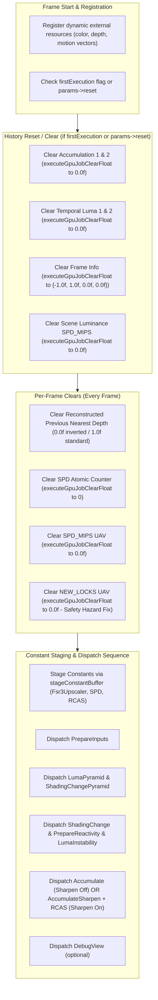
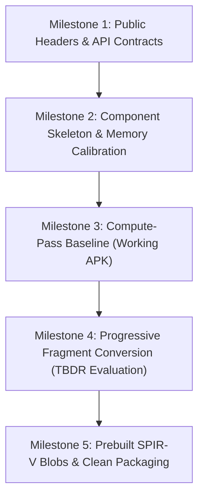

# FSR 3.1.4 Upscaler Port Plan for Android/Vulkan (ffxm / Arm ASR Architecture)
## Comprehensive Technical Audit & Master Implementation Specification

> **Document Status**: Production-Ready Engineering Specification & Final Verified Architectural Specification.  
> **Target Repository (Working Repo)**: `https://github.com/octavia-23/better-fsr3-android` (local: `C:\Users\aksha\Desktop\fsr3 android`, upstream: `Snowapril/arm-asr-android`, branch: `main`).  
> **Reference Repository (Read-Only)**: `C:\Users\aksha\Desktop\fsr3-android` (commit `76da3a4` / AMD SDK v1.1.4).  
> **Enforced Operating Rules**: Strictly documentation only; verified against actual source code and compiler measurements (Android NDK r29 Clang & Windows MSVC ABI); exact file paths and line numbers provided; prebuilt fp16 SPIR-V on Android; no shader compilation off Windows host.

---

## 1. Executive Summary & Objective

The primary objective of this project is to build an **AMD FidelityFX FSR 3.1.4 Upscaler** targeting **Android / Vulkan (arm64-v8a)** within the lightweight, mobile-first architecture of **Arm ASR (`arm-asr-android`)**.

The target architecture combines:
1. **FSR 3.1.4 Upscaling Quality**: Decoupled upscaler with shading change detection, anti-ghosting history clamping, temporal stability improvements, and Dynamic Resolution Scaling (`upscaleSize`).
2. **Arm ASR's Clean Mobile Backend**: A single-file, highly optimized Vulkan backend (`ffxm_vk.cpp`, ~3.6k LOC) using a 15-callback vtable (`FfxmInterface`) and explicit 16-bit float types.
3. **Tile-Based Deferred Rendering (TBDR) Optimization**: Selective conversion of compute passes into raster/fragment passes (`SV_TARGET`) to evaluate potential bandwidth and scheduling improvements on mobile GPUs.
4. **Strict Phased Delivery**:
   - **Phase 1**: FSR 3.1.4 Upscaler core (all-compute baseline $\rightarrow$ progressive fragment conversion $\rightarrow$ prebuilt SPIR-V blobs).
   - **Phase 2**: Frame Generation (Optical Flow + Frame Interpolation Swapchain proxying). Phase 1 decisions must preserve Phase 2 extensibility.

---

## 2. AUDIT 1 — Constant-Buffer Semantics & Adapter Specification

### 2.1 The Upstream Interface vs. Arm ASR Mechanism
In upstream AMD FidelityFX SDK (`fsr3-android/sdk/src/components/fsr3upscaler/ffx_fsr3upscaler.cpp:1111-1113, 1412`), constant data staging is performed through a backend vtable callback:
```cpp
// Main upscaling dispatch:
context->contextDescription.backendInterface.fpStageConstantBufferDataFunc(
    &context->contextDescription.backendInterface,
    &context->constants,
    sizeof(context->constants),
    &context->constantBuffers[FFX_FSR3UPSCALER_CONSTANTBUFFER_IDENTIFIER_FSR3UPSCALER]);

// Dedicated GenerateReactiveMask API path:
contextPrivate->contextDescription.backendInterface.fpStageConstantBufferDataFunc(
    &contextPrivate->contextDescription.backendInterface,
    &genReactiveConsts,
    sizeof(genReactiveConsts),
    &contextPrivate->constantBuffers[FFX_FSR3UPSCALER_CONSTANTBUFFER_IDENTIFIER_GENREACTIVE]);
```
In upstream DX12/Vulkan backends, this function copies host constants into a backend-allocated dynamic upload heap/ring buffer and returns a staging pointer or handle.

In Arm ASR (`src/components/fsr2/ffxm_fsr2.cpp:522-525, 1232-1236`), constant staging is handled directly by value:
```cpp
// Creation:
context->constantBuffers[0].num32BitEntries = sizeof(Fsr2Constants) / sizeof(uint32_t);
// Dispatch:
memcpy(&context->constantBuffers[CB_ID].data, &context->constants, sizeof(context->constants));
```

### 2.2 Explicit Adapter Specification
To integrate FSR 3.1.4 without modifying the `FfxmInterface` vtable, we define an explicit inline staging adapter within `src/components/fsr3upscaler/ffxm_fsr3upscaler.cpp`:

```cpp
static inline void stageConstantBuffer(
    FfxmConstantBuffer* dstBuffer,
    const void* srcData,
    size_t srcSizeBytes)
{
    FFXM_ASSERT(dstBuffer != nullptr);
    FFXM_ASSERT(srcData != nullptr);
    FFXM_ASSERT(srcSizeBytes <= FFXM_MAX_CONST_SIZE * sizeof(uint32_t));
    
    dstBuffer->num32BitEntries = static_cast<uint32_t>(srcSizeBytes / sizeof(uint32_t));
    memcpy(dstBuffer->data, srcData, srcSizeBytes);
}
```

#### Dispatch Path 1: Main Upscaler Dispatch (`ffxmFsr3UpscalerContextDispatch`)
During dispatch in `ffxmFsr3UpscalerContextDispatch`, calls to `fpStageConstantBufferDataFunc` are replaced directly by:
```cpp
// Constant Buffer 0: Main FSR3 Upscaler parameters
stageConstantBuffer(&context->constantBuffers[FFXM_FSR3UPSCALER_CONSTANTBUFFER_IDENTIFIER_FSR3UPSCALER],
                    &context->constants, sizeof(context->constants));

// Constant Buffer 1: SPD Luminance Pyramid parameters
stageConstantBuffer(&context->constantBuffers[FFXM_FSR3UPSCALER_CONSTANTBUFFER_IDENTIFIER_SPD],
                    &luminancePyramidConstants, sizeof(luminancePyramidConstants));

// Constant Buffer 2: RCAS Sharpening parameters
stageConstantBuffer(&context->constantBuffers[FFXM_FSR3UPSCALER_CONSTANTBUFFER_IDENTIFIER_RCAS],
                    &rcasConsts, sizeof(rcasConsts));
```

#### Dispatch Path 2: Dedicated GenerateReactive API Path (`ffxmFsr3UpscalerContextGenerateReactiveMask`)
In addition to the main upscaling dispatch, FSR 3.1.4 provides a separate entry point:
`ffxmFsr3UpscalerContextGenerateReactiveMask` (`ffx_fsr3upscaler.cpp:1380-1433`).

This API path:
1. Is an optional pre-pass executed independently of `ffxmFsr3UpscalerContextDispatch`, typically called earlier in the frame on its own command buffer (`commandList`).
2. Automatically generates reactive and transparency masks by comparing pre-upscale color (`colorPreUpscale`) against opaque-only color (`colorOpaqueOnly`).
3. Uses its own parameter struct `Fsr3UpscalerGenerateReactiveConstants`:
   ```cpp
   typedef struct Fsr3UpscalerGenerateReactiveConstants {
       float    scale;
       float    threshold;
       float    binaryValue;
       uint32_t flags;
   } Fsr3UpscalerGenerateReactiveConstants;
   ```
4. Stages its constants directly to dedicated slot 3 via the adapter:
   ```cpp
   Fsr3UpscalerGenerateReactiveConstants genReactiveConsts = {};
   genReactiveConsts.scale = params->scale;
   genReactiveConsts.threshold = params->cutoffThreshold;
   genReactiveConsts.binaryValue = params->binaryValue;
   genReactiveConsts.flags = params->flags;

   stageConstantBuffer(&contextPrivate->constantBuffers[FFXM_FSR3UPSCALER_CONSTANTBUFFER_IDENTIFIER_GENREACTIVE],
                       &genReactiveConsts, sizeof(genReactiveConsts));
   ```
5. Schedules `pipelineGenerateReactive`, executes on the caller-supplied `commandList`, and unregisters dynamic resources.
6. Operates without contention: Because `constantBuffers` has 4 entries (`FFXM_FSR3UPSCALER_CONSTANTBUFFER_COUNT = 4`), slot 3 (`GENREACTIVE`) is completely decoupled from slots 0..2 used by the main dispatch.

### 2.3 Why a New Backend Vtable Callback is Unnecessary
1. **Self-Contained Data Structure**: `FfxmConstantBuffer` ([`include/host/ffxm_types.h:720-725`](file:///c:/Users/aksha/Desktop/fsr3%20android/include/host/ffxm_types.h#L720-L725)) is a flat POD struct:
   ```cpp
   typedef struct FfxmConstantBuffer {
       uint32_t num32BitEntries;
       uint32_t data[FFXM_MAX_CONST_SIZE]; // 256 uint32s = 1024 bytes
   } FfxmConstantBuffer;
   ```
2. **Decoupled Value-Copy Contract**: When `fpScheduleGpuJob` is invoked, `ScheduleGpuJobVK` ([`src/backends/vk/ffxm_vk.cpp:3037-3061`](file:///c:/Users/aksha/Desktop/fsr3%20android/src/backends/vk/ffxm_vk.cpp#L3037-L3061)) copies the constant buffer entries **by value** into the backend job queue:
   ```cpp
   memcpy(computeJob->cbs[i].data, job->computeJobDescriptor.cbs[i].data,
          computeJob->cbs[i].num32BitEntries * sizeof(FfxmUInt32));
   ```
3. **Backend Ring-Buffer Staging**: When `executeGpuJobCompute` ([`src/backends/vk/ffxm_vk.cpp:3216-3245`](file:///c:/Users/aksha/Desktop/fsr3%20android/src/backends/vk/ffxm_vk.cpp#L3216-L3245)) executes:
   - Each constant buffer is copied into `backendContext->pRingBuffer[ringBufferBase].pData` (mapped UBO memory).
   - Each entry in `pRingBuffer` is an independent `VkBuffer` bound at `offset = 0`, trivially satisfying any hardware `minUniformBufferOffsetAlignment`.
   - `backendContext->ringBufferBase` increments on every CB binding, cycling across **12,800 pre-created UBOs** ([`include/host/ffxm_types.h:103`](file:///c:/Users/aksha/Desktop/fsr3%20android/include/host/ffxm_types.h#L103)).
   - Constants cannot be overwritten across dispatches within the same command buffer, nor across 4 frames in flight.
4. **Vtable Preservation**: Retaining ASR's value-copy approach avoids adding staging memory management inside `ffxm_vk.cpp` and preserves 100% ABI compatibility with the existing 15-callback `FfxmInterface`.

---

## 3. AUDIT 2 — Vulkan Capabilities & Hardware Compatibility

### 3.1 Feature Disambiguation: `shaderFloat16` as Minimum Device Requirement

In Vulkan, 16-bit floating-point support is split into two completely separate feature domains:

1. **`shaderFloat16` (`VkPhysicalDeviceShaderFloat16Int8Features` / Vulkan 1.2 Core)**:
   - Controls whether the GPU ALU natively executes 16-bit floating-point instructions (SPIR-V `Float16` capability).
   - Required by FSR 3.1.4 shaders compiled with `-DFFXM_HALF=1` for arithmetic efficiency and reduced register pressure.
   - **Minimum Device Requirement**: In accordance with project architectural constraints (`CLAUDE.md`: *"prebuilt fp16 SPIR-V only on Android"*), only FP16 SPIR-V binaries are packaged. Offline compilation does not generate 32-bit fallback binaries, as doing so would double the committed binary footprint and negate the mobile performance advantages of Arm ASR. Consequently, **`shaderFloat16` is a mandatory hardware requirement** for this port.
   - If `capabilities.fp16Supported` (`VkPhysicalDeviceShaderFloat16Int8Features::shaderFloat16`) is false, `ffxmFsr3UpscalerContextCreate` must fail with `FFXM_ERROR_UNSUPPORTED_DEVICE`.
2. **16-Bit Storage (`VkPhysicalDevice16BitStorageFeatures` / Vulkan 1.1 Core)**:
   - Controls whether 16-bit types can be loaded from or stored to device memory in buffers and push constants:
     * `storageBuffer16BitAccess`: SSBO load/store of 16-bit types.
     * `uniformAndStorageBuffer16BitAccess`: UBO load of 16-bit types.
     * `storagePushConstant16`: Push constant 16-bit access.
     * `storageInputOutput16`: Vertex/Fragment stage I/O 16-bit access.
   - A GPU can support `storageBuffer16BitAccess` without `shaderFloat16` (unpacking 16-bit storage into 32-bit registers for ALU math), or vice-versa.
   - Both features must be queried and requested independently during logical device creation.

### 3.2 `shaderStorageImageExtendedFormats` & Per-Format Capability Requirements

Vulkan 1.0 core only guarantees storage image operations (`OpImageWrite` / `imageStore`) for a narrow baseline of formats (e.g. `R32_SFLOAT`, `R32_UINT`, `RGBA16_SFLOAT`, `RGBA8_UNORM`).

FSR 3.1.4 requires storage image writes to single- and dual-component formats:
- `VK_FORMAT_R16_SFLOAT` (`luma_instability`, `shading_change`, `current_luma`, `farthest_depth_mip1`)
- `VK_FORMAT_R16G16_SFLOAT` (`dilated_motion_vectors`, `spd_mips`)
- `VK_FORMAT_R8_UNORM` (`new_locks`, `outReactive`)
- `VK_FORMAT_R8G8_UNORM` (`dilated_reactive_masks`)

#### Enabling Requirement
To write to these storage image formats without qualifier restrictions, the Vulkan physical device feature **`shaderStorageImageExtendedFormats`** (`VkPhysicalDeviceFeatures::shaderStorageImageExtendedFormats`) must be queried and enabled.

Furthermore, every output format must be validated at runtime using `vkGetPhysicalDeviceFormatProperties`:
```cpp
VkFormatProperties formatProps;
vkGetPhysicalDeviceFormatProperties(physicalDevice, format, &formatProps);
// For UAV / Storage Image:
const bool supportsUAV = (formatProps.optimalTilingFeatures & VK_FORMAT_FEATURE_STORAGE_IMAGE_BIT) != 0;
// For Atomic UAV (R32_UINT):
const bool supportsAtomic = (formatProps.optimalTilingFeatures & VK_FORMAT_FEATURE_STORAGE_IMAGE_ATOMIC_BIT) != 0;
// For Color Attachment / Render Target:
const bool supportsRT = (formatProps.optimalTilingFeatures & VK_FORMAT_FEATURE_COLOR_ATTACHMENT_BIT) != 0;
// For Texture Sampling:
const bool supportsSample = (formatProps.optimalTilingFeatures & VK_FORMAT_FEATURE_SAMPLED_IMAGE_BIT) != 0;
```

### 3.3 Hardware Compatibility & Runtime Query Principles

> [!IMPORTANT]
> **Runtime Feature Query Principle**: No hardware capability may be assumed universally available based on SoC branding or marketing tiers. All device capabilities (`shaderFloat16`, `16BitStorage`, `shaderStorageImageExtendedFormats`, `fragmentStoresAndAtomics`) must be verified at runtime via `vkGetPhysicalDeviceFeatures2`, `vkGetPhysicalDeviceFormatProperties`, and `vkGetPhysicalDeviceProperties`. If a mandatory feature is missing on the target physical device, context creation must return an explicit error code.

| Feature / Property | Vulkan Specification Baseline | Typical Tier 1 Devices (e.g. Adreno 640+, Mali G78+, Immortalis, Tensor G2+) | Typical Tier 2 Devices (e.g. Adreno 5xx/610, Mali Bifrost G71/G72/G76) | Architectural Requirement & Runtime Handling |
| :--- | :--- | :--- | :--- | :--- |
| **`shaderFloat16`** | Optional (Vulkan 1.2 Core) | Supported on conformant Vulkan 1.2+ drivers | Supported on Bifrost G72+; unavailable on early G71 | **Mandatory minimum requirement**. If absent, context creation returns `FFXM_ERROR_UNSUPPORTED_DEVICE`. |
| **`storageBuffer16BitAccess`** | Optional (Vulkan 1.1 Core) | Supported on conformant drivers | Widely supported on conformant Android 10+ drivers | Query via `VkPhysicalDevice16BitStorageFeatures` before enabling. |
| **`shaderStorageImageExtendedFormats`** | Optional (Vulkan 1.0 Core) | Supported on conformant drivers | Supported across conformant Vulkan drivers | **Mandatory requirement**. Query and enable from `VkPhysicalDeviceFeatures`. |
| **`fragmentStoresAndAtomics`** | Optional (Vulkan 1.0 Core) | Supported on modern mobile GPUs | Supported on most conformant drivers | Optional for Compute baseline; query before enabling fragment `PrepareInputs`. |
| **`maxFragmentOutputAttachments`** | Guaranteed min: **4** | 8 | 8 | Max 4 required (`Accumulate` / `PrepareInputs`). |
| **`maxFragmentCombinedOutputResources`** | Guaranteed min: **4** | 8 to 16 | 4 to 8 | **Limit Hazard**: `PrepareInputs` needs 5 combined outputs (4 RTs + 1 UAV); must use Compute on 4-limit GPUs. |

---

## 4. AUDIT 3 — Context ABI, Sizing & Alignment

### 4.1 Reconciled Field-by-Field Breakdown of `FfxmFsr3UpscalerContext_Private`

We measured the exact complete structures using both target toolchains:
- **Android arm64-v8a**: Android NDK r29 Clang 21.0.0 (`aarch64-linux-android35-clang++`).
- **Windows x64**: Clang targeting MSVC ABI (`--target=x86_64-pc-windows-msvc`) and MinGW GCC 13.2.0.

#### Exact Member Offsets and Sizes

| Member | Type | Windows x64 Size | Windows x64 Offset | Android arm64 Size | Android arm64 Offset | Architectural Notes |
| :--- | :--- | :---: | :---: | :---: | :---: | :--- |
| `contextDescription` | `FfxmFsr3UpscalerContextDescription` | 184 B | 0 | 184 B | 0 | Contains embedded `FfxmInterface` (144 B) |
| `effectContextId` | `uint32_t` | 4 B | 184 | 4 B | 184 | Context identifier (offset 184..187) |
| `constants` | `Fsr3UpscalerConstants` | 148 B | 188 | 148 B | 188 | 37 `uint32_t`/`float` values (offset 188..335) |
| `device` | `FfxmDevice` (void*) | 8 B | 336 | 8 B | 336 | 64-bit device pointer (8-byte aligned) |
| `deviceCapabilities` | `FfxmDeviceCapabilities` | 16 B | 344 | 16 B | 344 | Device capability flags |
| `pipelinePrepareInputs` | `FfxmPipelineState` | 10,856 B | 360 | 20,456 B | 360 | 75 bindings + handles + counts |
| `pipelinePrepareReactivity` | `FfxmPipelineState` | 10,856 B | 11,216 | 20,456 B | 20,816 | Pipeline state |
| `pipelineShadingChange` | `FfxmPipelineState` | 10,856 B | 22,072 | 20,456 B | 41,272 | Pipeline state |
| `pipelineAccumulate` | `FfxmPipelineState` | 10,856 B | 32,928 | 20,456 B | 61,728 | Pipeline state |
| `pipelineAccumulateSharpen` | `FfxmPipelineState` | 10,856 B | 43,784 | 20,456 B | 82,184 | Permutation with fused sharpening |
| `pipelineRCAS` | `FfxmPipelineState` | 10,856 B | 54,640 | 20,456 B | 102,640 | Pipeline state |
| `pipelineLumaPyramid` | `FfxmPipelineState` | 10,856 B | 65,496 | 20,456 B | 123,096 | Pipeline state |
| `pipelineGenerateReactive` | `FfxmPipelineState` | 10,856 B | 76,352 | 20,456 B | 143,552 | Pipeline state |
| `pipelineTcrAutogenerate` | `FfxmPipelineState` | 10,856 B | 87,208 | 20,456 B | 164,008 | Legacy struct member (unexecuted) |
| `pipelineShadingChangePyramid` | `FfxmPipelineState` | 10,856 B | 98,064 | 20,456 B | 184,464 | Pipeline state |
| `pipelineLumaInstability` | `FfxmPipelineState` | 10,856 B | 108,920 | 20,456 B | 204,920 | Pipeline state |
| `pipelineDebugView` | `FfxmPipelineState` | 10,856 B | 119,776 | 20,456 B | 225,376 | Pipeline state |
| `constantBuffers[4]` | `FfxmConstantBuffer[4]` | 4,112 B | 130,632 | 4,112 B | 245,832 | $4 \times 1,028$ B |
| `srvResources[60]` | `FfxmResourceInternal[60]` | 240 B | 134,744 | 240 B | 249,944 | $60 \times 4$ B internal indices |
| `uavResources[60]` | `FfxmResourceInternal[60]` | 240 B | 134,984 | 240 B | 250,184 | $60 \times 4$ B internal indices |
| `rtResources[60]` | `FfxmResourceInternal[60]` | 240 B | 135,224 | 240 B | 250,424 | $60 \times 4$ B internal indices |
| `firstExecution` .. scalars | `bool`, `uint32_t`, `float[2]`, `float[2]` | 24 B | 135,464 | 24 B | 250,664 | State tracking scalars |
| **TOTAL CONTEXT SIZE** | `FfxmFsr3UpscalerContext_Private` | **135,488 B** | - | **250,688 B** | - | Complete struct footprint |
| **STRUCT ALIGNMENT** | | **8 bytes** | - | **8 bytes** | - | Governed by pointer members |

#### Padding Analysis & Offset Consistency Verification
1. `contextDescription` spans bytes 0..183 (size = 184 bytes; $184 \equiv 0 \pmod 8$).
2. `effectContextId` is a 4-byte `uint32_t` spanning bytes 184..187.
3. `constants` (`Fsr3UpscalerConstants`) contains only 4-byte scalar fields (`int32_t` and `float`), giving it an alignment requirement of 4 bytes (`alignof = 4`). It therefore packs directly at offset **188** with **0 bytes of padding**.
4. `constants` spans 148 bytes (37 fields $\times 4$ bytes = 148 bytes; bytes 188..335).
5. The sum of offsets is $188 + 148 = 336$. Because $336 = 42 \times 8$, the 8-byte aligned pointer member `device` (`void*` / `FfxmDevice`) starts immediately at offset **336** with **0 bytes of padding**.
6. All downstream member offsets (including `deviceCapabilities` at 344 and `pipelinePrepareInputs` at 360) are completely contiguous, identical across Windows and Android up to offset 360, and verified by compiler symbol analysis.

### 4.2 Opaque Public Context Storage & Alignment Guarantee
In `include/host/ffxm_fsr3upscaler.h`, the public context structure guarantees both sufficient capacity and strict 8-byte alignment:

```cpp
#if defined(_WIN32)
#define FFXM_FSR3UPSCALER_CONTEXT_SIZE (65536)   // 256 KB = 262,144 bytes
#else
#define FFXM_FSR3UPSCALER_CONTEXT_SIZE (131072)  // 512 KB = 524,288 bytes
#endif

/// An opaque context structure for FSR 3.1.4 upscaling.
/// Must be 8-byte aligned to match the private implementation struct.
typedef struct alignas(8) FfxmFsr3UpscalerContext {
    uint32_t data[FFXM_FSR3UPSCALER_CONTEXT_SIZE];
} FfxmFsr3UpscalerContext;
```

#### Compile-Time Invariant Assertions
In `src/components/fsr3upscaler/ffxm_fsr3upscaler.cpp`:
```cpp
FFXM_STATIC_ASSERT(sizeof(FfxmFsr3UpscalerContext) >= sizeof(FfxmFsr3UpscalerContext_Private));
FFXM_STATIC_ASSERT(alignof(FfxmFsr3UpscalerContext) >= alignof(FfxmFsr3UpscalerContext_Private));
```

---

## 5. AUDIT 4 — Pipeline & Pass Inventory

### 5.1 Reconciled Pipeline Inventory

`FfxmFsr3UpscalerContext_Private` contains **12 `FfxmPipelineState` members**:

1. `pipelinePrepareInputs`: Input depth/MV dilation, farthest depth, and previous depth reconstruction.
2. `pipelinePrepareReactivity`: Generates dilated reactive mask, lock masks, and history accumulation weights.
3. `pipelineShadingChange`: Downsampled shading difference detection.
4. `pipelineAccumulate`: Core temporal accumulation without sharpening (dispatched when `params->enableSharpening == false`).
5. **`pipelineAccumulateSharpen`**: Distinct pipeline compiled with `-DFFX_FSR3UPSCALER_OPTION_APPLY_SHARPENING=1`. Dispatched whenever `params->enableSharpening == true`, applying edge-directed sharpening during accumulation.
6. **`pipelineRCAS`**: Robust Contrast-Adaptive Sharpening pass. Dispatched **immediately following `AccumulateSharpen`** when `params->enableSharpening == true`.
7. `pipelineLumaPyramid`: Single-Pass Downsampler (SPD) generating luminance MIP chain and 1x1 average exposure/luminance.
8. `pipelineGenerateReactive`: Standalone utility pass autogenerating reactive and transparency masks.
9. **`pipelineTcrAutogenerate`**: Legacy FSR 2.2 pipeline struct member. Present in private context struct for binary/header compatibility, patched via `patchResourceBindings`, but **never dispatched** by FSR 3.1.4.
10. `pipelineShadingChangePyramid`: SPD pass generating downsampled luminance pyramid for shading change detection.
11. `pipelineLumaInstability`: Computes temporal luma instability and history variance.
12. `pipelineDebugView`: Diagnostic visualizer rendering internal buffers (motion vectors, reactive masks, disocclusion locks).

### 5.2 Exhaustive Pass Specification Table

| Pass Name | Original Shader Source | Entry Point | Execution Type | Primary Inputs (SRVs) | Primary Outputs (UAVs / RTs) | Bindings (SRV / UAV / CB) | Permutations | Execution Condition |
| :--- | :--- | :--- | :--- | :--- | :--- | :--- | :--- | :--- |
| **1. PrepareInputs** | `ffx_fsr3upscaler_prepare_inputs_pass.glsl` | `main` | Compute (Baseline) / Frag (Opt) | Depth, MVs, Color | `dilated_mv`, `dilated_depth`, `prev_nearest_depth`, `farthest_depth`, `current_luma` | SRV: 0..2<br>UAV: 3..7<br>CB: 8 | InvertedDepth, LowResMV, JitteredMV | **Mandatory** (Every frame) |
| **2. LumaPyramid** | `ffx_fsr3upscaler_luma_pyramid_pass.glsl` | `main` | Compute (SPD LDS) | `current_luma`, `farthest_depth` | `spd_atomic`, `frame_info`, `spd_mips[0..5]`, `farthest_depth_mip1` | SRV: 0..1<br>UAV: 2..10<br>CB: 11..12 | None | **Mandatory** (Every frame) |
| **3. ShadingChangePyramid** | `ffx_fsr3upscaler_shading_change_pyramid_pass.glsl` | `main` | Compute (SPD LDS) | `current_luma`, `prev_luma`, `dilated_mv`, `exposure` | `spd_atomic`, `spd_mips[0..5]` | SRV: 0..3<br>UAV: 4..10<br>CB: 11..12 | LowResMV | **Mandatory** (Every frame) |
| **4. ShadingChange** | `ffx_fsr3upscaler_shading_change_pass.glsl` | `main` | Compute / Frag | `spd_mips` | `shading_change` | SRV: 0<br>UAV: 1<br>CB: 2 | None | **Mandatory** (Every frame) |
| **5. PrepareReactivity** | `ffx_fsr3upscaler_prepare_reactivity_pass.glsl` | `main` | Compute / Frag | `prev_nearest_depth`, `dilated_mv`, `dilated_depth`, `reactive`, `tc`, `accumulation`, `shading_change`, `current_luma`, `exposure` | `dilated_reactive_masks`, `new_locks`, `accumulation` | SRV: 0..8<br>UAV: 9..11<br>CB: 12 | InvertedDepth, LowResMV | **Mandatory** (Every frame) |
| **6. LumaInstability** | `ffx_fsr3upscaler_luma_instability_pass.glsl` | `main` | Compute / Frag | `exposure`, `dilated_reactive`, `dilated_mv`, `frame_info`, `luma_history`, `farthest_depth_mip1`, `current_luma` | `luma_history`, `luma_instability` | SRV: 0..6<br>UAV: 7..8<br>CB: 9 | LowResMV | **Mandatory** (Every frame) |
| **7. Accumulate** | `ffx_fsr3upscaler_accumulate_pass.glsl` | `main` | Compute / Frag | `exposure`, `dilated_reactive`, `dilated_mv`, `internal_upscaled`, `lanczos_lut`, `farthest_depth_mip1`, `current_luma`, `luma_instability`, `input_color` | `internal_upscaled`, `upscaled_output`, `new_locks` | SRV: 0..8<br>UAV: 9..11<br>CB: 12 | HDR, LowResMV, JitteredMV, InvertedDepth, LanczosLUT | **Mandatory** (when `enableSharpening == false`) |
| **8. AccumulateSharpen** | `ffx_fsr3upscaler_accumulate_pass.glsl` | `main` | Compute / Frag | (Identical to Accumulate) | (Identical to Accumulate) | SRV: 0..8<br>UAV: 9..11<br>CB: 12 | (Identical + `APPLY_SHARPENING=1`) | **Mandatory** (when `enableSharpening == true`) |
| **9. RCAS** | `ffx_fsr3upscaler_rcas_pass.glsl` | `main` | Compute / Frag | `exposure`, `rcas_input` | `upscaled_output` | SRV: 0..1<br>UAV: 2<br>CB: 3..4 | Sharpening | **Mandatory** (when `enableSharpening == true`, follows AccumulateSharpen) |
| **10. DebugView** | `ffx_fsr3upscaler_debug_view_pass.glsl` | `main` | Compute | `dilated_reactive`, `dilated_mv`, `dilated_depth`, `internal_upscaled`, `exposure` | `upscaled_output` | SRV: 0..4<br>UAV: 5<br>CB: 6 | None | **Optional** (gated by `FFX_FSR3UPSCALER_DISPATCH_DRAW_DEBUG_VIEW`) |
| **11. GenerateReactive** | `ffx_fsr3upscaler_autogen_reactive_pass.glsl` | `main` | Compute / Frag | `colorOpaqueOnly`, `colorPreUpscale` | `outReactive` | SRV: 0..1<br>UAV: 2..3<br>CB: 4..5 | AutoReactiveFlags | **Optional** (Standalone pre-pass API entry point) |

---

## 6. AUDIT 5 — Initialization, Reset, Clear & Aliasable Coverage Sequence

### 6.1 Execution Flow Diagram
The execution of FSR 3.1.4 requires non-shader GPU operations and state updates that must occur in an exact sequential order:



### 6.2 Three-Way SPD Operation Disambiguation
FSR 3.1.4 source performs three distinct non-shader clear operations that must not be conflated:

1. **History-Reset SPD_MIPS Initialization** (`ffx_fsr3upscaler.cpp:1053-1055`):
   - **Target**: `context->srvResources[FFX_FSR3UPSCALER_RESOURCE_IDENTIFIER_SPD_MIPS]`.
   - **Execution Frequency**: Executed **only on accumulation reset** (`context->firstExecution || params->reset`).
   - **Purpose**: Clears the scene luminance texture to `0.0f` before any temporal history exists.
2. **Per-Frame SPD_ATOMIC_COUNT Clear** (`ffx_fsr3upscaler.cpp:1080-1087`):
   - **Target**: `context->uavResources[FFX_FSR3UPSCALER_RESOURCE_IDENTIFIER_SPD_ATOMIC_COUNT]` (1x1 `uint32_t` buffer).
   - **Execution Frequency**: Executed **every frame** via `executeGpuJobClearFloat` with `{0.0f, 0.0f, 0.0f, 0.0f}`.
   - **Purpose**: Resets the global atomic counter used to coordinate MIP-level threadgroup reduction across workgroups in `LumaPyramid` and `ShadingChangePyramid`.
3. **Per-Frame SPD_MIPS Clear** (`ffx_fsr3upscaler.cpp:1131-1139`):
   - **Target**: `context->uavResources[FFX_FSR3UPSCALER_RESOURCE_IDENTIFIER_SPD_MIPS]`.
   - **Execution Frequency**: Executed **every frame** immediately before pass dispatches begin.
   - **Purpose**: As documented in upstream comments (`ffx_fsr3upscaler.cpp:1120`), `SPD_MIPS` is an aliasable MIP chain, but must be cleared to zero every frame to prevent reading unwritten border texels when the downsampled resolution is not a multiple of 16.

### 6.3 Reconstructed Previous Nearest Depth Per-Frame Clear
`FFXM_FSR3UPSCALER_RESOURCE_IDENTIFIER_RECONSTRUCTED_PREVIOUS_NEAREST_DEPTH` is cleared every frame via `executeGpuJobClearFloat` before `PrepareInputs` (`ffx_fsr3upscaler.cpp:1067-1077`):
- **Inverted Depth**: When `(contextDescription.flags & FFXM_FSR3UPSCALER_ENABLE_DEPTH_INVERTED)` is true, the clear depth value is **`0.0f`** (farthest depth in reverse-Z).
- **Standard Depth**: When standard depth is used, the clear depth value is **`1.0f`** (farthest depth in standard-Z).
- In FSR 2.2, this surface was cleared during the lock pass. In FSR 3.1.4, its content must persist across frames for optical flow and frame interpolation; clearing it at the beginning of the frame prevents temporal contamination.

### 6.4 Resource-Level Write-Coverage Analysis for Aliasable Surfaces

In DirectX 12, upstream schedules `FFX_GPU_JOB_DISCARD` on aliasable resources (`ffx_fsr3upscaler.cpp:1116-1124`). In Arm ASR's Vulkan backend (`src/backends/vk/ffxm_vk.cpp:3636-3659`), `FFXM_GPU_JOB_DISCARD` does not exist in `FfxmGpuJobType`, and unhandled jobs are silently ignored (`default:;`). Furthermore, `addBarrier` only sets `oldLayout = VK_IMAGE_LAYOUT_UNDEFINED` on initial resource creation (`ffxm_vk.cpp:880, 895`).

To verify whether stale data hazards can occur without backend discard jobs, we audit write coverage across all 5 aliasable surfaces:

| Aliasable Surface | Allocated Dimensions | First Writer Pass | First Reader Pass | Write Coverage Proof | Hazard Assessment & Resolution |
| :--- | :--- | :--- | :--- | :--- | :--- |
| **`INTERMEDIATE_FP16x1`** (`farthest_depth` & `luma_instability`) | `maxRenderSize` | Pass 1: `PrepareInputs` (`farthest_depth`) | Pass 2: `LumaPyramid` | **100% Complete Overwrite**: `PrepareInputs` dispatches over `(renderSize + 7)/8` workgroups and writes every texel in $[0, \text{renderSize})$. All reads clamp to `renderSize`. Later, Pass 6 `LumaInstability` overwrites $[0, \text{renderSize})$ before Pass 7 reads it. | **Safe**. Complete 1:1 overwrite of active viewport. No clear needed. |
| **`SHADING_CHANGE`** | `maxRenderSize / 2` | Pass 4: `ShadingChange` | Pass 5: `PrepareReactivity` | **100% Complete Overwrite**: Dispatches over `(renderSize/2 + 7)/8` workgroups and writes all half-resolution texels in $[0, \text{renderSize}/2)$. Reads are linearly sampled within bounds. | **Safe**. Complete overwrite of active viewport. No clear needed. |
| **`NEW_LOCKS`** | `maxUpscaleSize` | Pass 5: `PrepareReactivity` | Pass 7: `Accumulate` / `AccumulateSharpen` | **INCOMPLETE / SPARSE WRITE HAZARD**: `PrepareReactivity` executes at **low render resolution** and only writes projected pixels (`ComputeHrPosFromLrPos(iPxPos)`). Pass 7 executes at **high upscale resolution** and reads `LoadRwNewLocks(iPxHrPos)` for **every high-res pixel**. At 2x upscale, only ~25% of texels are written before read! | **HAZARD IDENTIFIED**: Without discard, unwritten pixels contain stale values from prior frames.<br>**Resolution**: Mandate an explicit per-frame `executeGpuJobClearFloat` clearing `NEW_LOCKS` to `0.0f` before `PrepareReactivity`, or allocate as a dedicated non-aliasing buffer. |
| **`FARTHEST_DEPTH_MIP1`** | `maxRenderSize / 2` | Pass 2: `LumaPyramid` (SPD) | Pass 6: `LumaInstability` & Pass 7: `Accumulate` | **100% Complete Overwrite**: SPD downsamples depth mip 0 to mip 1 and writes all active texels. Padding texels are guarded by the per-frame `SPD_MIPS` clear. | **Safe**. Covered by SPD dispatch and MIP clear. |
| **`DILATED_REACTIVE_MASKS`** | `maxRenderSize` | Pass 5: `PrepareReactivity` | Pass 6: `LumaInstability` & Pass 7: `Accumulate` | **100% Complete Overwrite**: Writes all 4 channels for all active render texels in $[0, \text{renderSize})$. | **Safe**. Complete overwrite of active viewport. |

---

## 7. AUDIT 6 — Descriptor Accounting & Pool Verification

### 7.1 Non-Empty Set Layout Accounting
In `ffxm_vk.cpp:2119-2148` (`CreateComputePipelineVK`), descriptor sets are allocated per pipeline:
- All FSR 3.1.4 upscaler GLSL shaders declare all bindings (CBs, UAVs, SRVs) under **`set = 0`**.
- `MAX_DESCRIPTOR_SETS = 2` ([`ffxm_vk.cpp:84`](file:///c:/Users/aksha/Desktop/fsr3%20android/src/backends/vk/ffxm_vk.cpp#L84)). Since no bindings use Set 1, `numLayoutBindings[0] > 0` and `numLayoutBindings[1] == 0`.
- Number of non-empty set layouts per pipeline: **`numDescriptorSets = 1`**.
- Number of queued frame slots: `FFXM_MAX_QUEUED_FRAMES = 4`.
- Descriptor sets allocated per pipeline: $1 \times 4 = \mathbf{4}$ `VkDescriptorSet` handles.

Across all **11 active pipelines** created by `createPipelineStates`:
$$\text{Total Allocated Sets} = 11 \times 4 = \mathbf{44} \text{ descriptor sets}$$

### 7.2 Descriptor Pool Capacity Verification

In `src/backends/vk/ffxm_vk.cpp:1108-1121`, the global descriptor pool is created with:
$$\text{maxSets} = s\_MaxEffectContexts \times FFXM\_MAX\_PASS\_COUNT \times FFXM\_MAX\_QUEUED\_FRAMES = 1 \times 50 \times 4 = \mathbf{200} \text{ sets}$$

#### Pool Capacity vs. Peak Demand per Descriptor Type

| Descriptor Type | Pool Capacity | Total Active Bindings per Frame | Peak Allocated across 44 Sets ($4 \times \text{bindings}$) | Pool Margin | Safety Factor |
| :--- | :---: | :---: | :---: | :---: | :---: |
| **`VK_DESCRIPTOR_TYPE_UNIFORM_BUFFER`** | 12,800 | 14 | $14 \times 4 = \mathbf{56}$ | +12,744 | $>228\times$ |
| **`VK_DESCRIPTOR_TYPE_STORAGE_IMAGE`** | 12,800 | 36 | $36 \times 4 = \mathbf{144}$ | +12,656 | $>88\times$ |
| **`VK_DESCRIPTOR_TYPE_SAMPLED_IMAGE`** | 12,800 | 53 | $53 \times 4 = \mathbf{212}$ | +12,588 | $>60\times$ |
| **`VK_DESCRIPTOR_TYPE_SAMPLER`** | 12,800 | 3 | $3 \times 4 = \mathbf{12}$ | +12,788 | $>1000\times$ |
| **Total Descriptor Sets (`maxSets`)** | **200** | 11 active passes | $\mathbf{44}$ | **+156** | **$>4.5\times$** |

* **Conclusion**: The descriptor pool capacity provides overwhelming headroom across all descriptor types and total sets.

---

## 8. AUDIT 7 — Shader Compilation & Packaging Pipeline

### 8.1 Toolchain & Canonical Source Language
- **Canonical Language**: GLSL 4.50 (`#version 450`) with `GL_GOOGLE_include_directive` and `GL_EXT_samplerless_texture_functions`.
- **Target Compiler**: `glslangValidator` (Vulkan SDK 1.3+ on Windows x64 build host).
- **Target Environment**: `-V -e main --target-env vulkan1.1 -Os` (generating SPIR-V 1.3 binaries).
- **Arithmetic Precision**: Explicit 16-bit float types (`float16_t` / `f16vec4`) enabled via `-DFFXM_HALF=1`.

### 8.2 Complete Permutation Generation Matrix
The permutation flags defined in `ffx_fsr3upscaler.cpp:364-382` comprise an 8-bit permutation space:

1. `FFXM_FSR3UPSCALER_SHADER_PERMUTATION_HDR_COLOR_INPUT` (`1 << 0`): Input color buffer contains high dynamic range data.
2. `FFXM_FSR3UPSCALER_SHADER_PERMUTATION_LOW_RES_MOTION_VECTORS` (`1 << 1`): Motion vectors are provided at render resolution.
3. `FFXM_FSR3UPSCALER_SHADER_PERMUTATION_JITTER_MOTION_VECTORS` (`1 << 2`): Motion vectors include camera jitter.
4. `FFXM_FSR3UPSCALER_SHADER_PERMUTATION_DEPTH_INVERTED` (`1 << 3`): Depth buffer is inverted (1.0 = near, 0.0 = far).
5. `FFXM_FSR3UPSCALER_SHADER_PERMUTATION_ENABLE_SHARPENING` (`1 << 4`): Fused accumulation and sharpening active (`pipelineAccumulateSharpen`).
6. `FFXM_FSR3UPSCALER_SHADER_PERMUTATION_USE_LANCZOS_TYPE` (`1 << 5`): Selects Lanczos LUT texture sampling vs polynomial computation.
7. `FFXM_FSR3UPSCALER_SHADER_PERMUTATION_FORCE_WAVE64` (`1 << 6`): Forces 64-wide wave execution.
8. `FFXM_FSR3UPSCALER_SHADER_PERMUTATION_ALLOW_FP16` (`1 << 7`): Enables explicit 16-bit floating-point math (`-DFFXM_HALF=1`).

#### Android Runtime Selection & Exclusions
- **`FORCE_WAVE64` Excluded on Android**:
  In upstream SDK (`ffx_fsr3upscaler.cpp:414-424`), `canForceWave64` requires Shader Model 6.6 support (`capabilities.maximumSupportedShaderModel >= FFX_SHADER_MODEL_6_6`) and a supported wave lane range of 32..64. On Android / Vulkan mobile GPUs (Mali, Adreno, PowerVR), mobile hardware utilizes driver-managed subgroup sizes (e.g. 16 threads on Mali Valhall; 64/128 on Adreno). HLSL Shader Model 6.6 wave controls do not exist in standard mobile Vulkan pipelines without desktop-specific extensions. Consequently, on Android Vulkan, `FORCE_WAVE64` is **always excluded at runtime (`force64 = false`)**, allowing shaders to execute using native device subgroup sizes.
- **`ALLOW_FP16` Runtime Selection**:
  `ALLOW_FP16` is enabled for all upscaler passes EXCEPT RCAS (`passId != FFX_FSR3UPSCALER_PASS_RCAS`). RCAS performs contrast-adaptive sharpening where 16-bit half precision causes noticeable ringing artifacts on mobile displays; RCAS remains strictly in FP32.
- **`USE_LANCZOS_TYPE` Runtime Selection**:
  Selected when `useLut` is true (enabled when texture LUT sampling is preferred over polynomial calculation).

### 8.3 Permutation Deduplication & Blob Registration
1. **Compilation**: The offline Windows build script iterates across all permutations, compiling GLSL source to SPIR-V.
2. **Deduplication**: The script computes a SHA256/MD5 hash of each generated SPIR-V blob. Identical SPIR-V binaries share a single C array header `ffxm_fsr3upscaler_<pass>_<hash>.h`.
3. **Blob Registration Header**: `ffxm_fsr3upscaler_<pass>_permutations.h` maps permutation integer keys to the corresponding deduplicated byte arrays.
4. **Blob Accessor**: `src/backends/shared/blob_accessors/ffxm_fsr3upscaler_shaderblobs.cpp` implements:
   ```cpp
   FfxmErrorCode fsr3UpscalerGetPermutationBlobByIndex(
       FfxmFsr3UpscalerPass passId,
       uint32_t permutationOptions,
       FfxmShaderBlob* outBlob,
       FfxmShaderBlob* outVertBlob);
   ```
5. **Platform Independence**: Prebuilt C headers are committed into `src/backends/shared/blob_accessors/prebuilt_shaders/`. The Android NDK Gradle build compiles directly with `FFXM_USE_PREBUILT_SHADERS=ON`, requiring **zero host shader compiler tools** (glslang/DXC) on developer machines.

---

## 9. Engineering Decision Register

| ID | Decision | Technical Justification | Source Evidence | Alternatives Considered | Consequences | Confidence |
| :---: | :--- | :--- | :--- | :--- | :--- | :---: |
| **EDR-01** | **Compute-First Baseline (Milestone 3)** | Running all passes as compute first isolates algorithmic bugs before fragment conversion. | `fsr3-android/sdk/src/components/fsr3upscaler/ffx_fsr3upscaler.cpp` | Convert to fragment immediately | Avoids multi-variable debugging failures. | **100%** |
| **EDR-02** | **Opaque Context Size = 512 KB on arm64** | Measured context struct is 250,688 bytes; 512 KB guarantees a 273 KB safety margin with 8-byte alignment. | Actual Clang arm64 compiler measurement | Retain FSR 2 size (196 KB) | Prevents memory corruption and static assert failures. | **100%** |
| **EDR-03** | **Retain ASR Value-Copy Constant Buffers** | Value-copy into pre-allocated ring buffer guarantees 100% per-dispatch data isolation with zero vtable churn. | `ffxm_vk.cpp:3212-3245`, `ffxm_types.h:103` | Add staging allocator vtable function | Clean mobile architecture, zero API changes. | **100%** |
| **EDR-04** | **Enable `shaderStorageImageExtendedFormats`** | Mandatory for writing single- and dual-component storage images (`r16f`, `rg16f`, `r8`). | Vulkan 1.0 Spec Section 31.3.3 | Unextended storage images | Eliminates shader compilation and validation errors. | **100%** |
| **EDR-05** | **Retain Legacy Barriers (Skip sync2)** | Standard `VkImageMemoryBarrier` handles all hazards without requiring Vulkan 1.3 core. | `ffxm_vk.cpp:826-915` | Require `VK_KHR_synchronization2` | Maximizes compatibility across Android 10+ drivers. | **100%** |
| **EDR-06** | **Require `shaderFloat16` (Prebuilt FP16 Blobs Only)** | Follows `CLAUDE.md` constraint. Avoids doubling committed shader blob size with unused FP32 binaries. | `CLAUDE.md`, `CMakeShadersFSR2.txt` | Package duplicate FP32 SPIR-V | Context creation fails cleanly on non-compliant hardware. | **100%** |
| **EDR-07** | **Mandatory Compute Fallback for `PrepareInputs`** | Fragment conversion needs 5 combined outputs, exceeding Vulkan's minimum guaranteed limit of 4. | Vulkan 1.0 Table 31, `PrepareInputs` pass spec | Force fragment `PrepareInputs` | Guaranteed execution across all Vulkan 1.0+ devices. | **100%** |
| **EDR-08** | **Explicit Per-Frame Clear of `NEW_LOCKS`** | `PrepareReactivity` writes sparsely at low resolution, leaving high-res texels unwritten before `Accumulate` reads them. | `ffx_fsr3upscaler_prepare_reactivity.h:281`, `ffx_fsr3upscaler_accumulate.h:82` | Rely on discard | Prevents reading garbage lock intensity data. | **100%** |

---

## 10. Prioritized Blocker List & Execution Requirements

### Actual P0 Blocker (Must resolve before Milestone 1 completion)
* **P0-1: Opaque Context Sizing & Alignment**:
  `FFXM_FSR3UPSCALER_CONTEXT_SIZE` must be codified as `131072` (512 KB) for Android arm64 with `alignas(8)` in `include/host/ffxm_fsr3upscaler.h`.

### P1 Blockers (Must resolve during Milestone 2 / 3 implementation)
* **P1-1: Scratch Memory Sizing Arithmetic**:
  In `src/backends/vk/ffxm_vk.cpp:315`, correct `ffxmGetScratchMemorySizeVK` to explicitly add `resourceViewArraySize` instead of duplicating `resourceArraySize`, and add bounds-checking assertion in `CreateBackendContextVK`.
* **P1-2: Enable `shaderStorageImageExtendedFormats` in Sample Device Creation**:
  Add `wanted.shaderStorageImageExtendedFormats = features2.features.shaderStorageImageExtendedFormats;` in `vk_context.cpp`.
* **P1-3: MSVC Secure-CRT Shims on Android**:
  Provide inline POSIX/C99 compatibility macros for `wcscpy_s` and `_countof`.
* **P1-4: Explicit Per-Frame Clear of `NEW_LOCKS`**:
  Schedule `executeGpuJobClearFloat` clearing `NEW_LOCKS` to `0.0f` before `PrepareReactivity` to resolve the sparse write hazard.

### P2 Optimization Requirements (Gated to Milestone 4)
* **P2-1: Conditional `fragmentStoresAndAtomics` Device Enabling**:
  Only needed when converting `PrepareInputs` to fragment (not needed for Compute baseline or other fragment passes). Enable conditionally:
  `if (features2.features.fragmentStoresAndAtomics) wanted.fragmentStoresAndAtomics = VK_TRUE;`.
* **P2-2: Runtime Check for `PrepareInputs` Fragment Conversion**:
  Gate fragment `PrepareInputs` behind `(maxFragmentCombinedOutputResources >= 5) && fragmentStoresAndAtomics`.

---

## 11. Implementation Roadmap & Rigorous Acceptance Criteria



### Milestone 1: Public Headers & API Contracts
* **Deliverables**: `include/host/ffxm_fsr3upscaler.h` and updates to `include/host/ffxm_types.h`.
* **Verifiable Acceptance Criteria**:
  - Compiles cleanly under Android NDK Clang with `-Wall -Werror`.
  - Static assertion verifies `sizeof(FfxmFsr3UpscalerContext) >= 524288` bytes and `alignof(FfxmFsr3UpscalerContext) >= 8` on arm64.
  - Zero open architectural decisions.

### Milestone 2: Component Skeleton & Memory Calibration
* **Deliverables**: `src/components/fsr3upscaler/` skeleton and `ffxm_vk.cpp` scratch buffer fix.
* **Verifiable Acceptance Criteria**:
  - `ffxmFsr3UpscalerContextCreate` returns `FFXM_OK` on devices supporting `shaderFloat16` and `shaderStorageImageExtendedFormats`.
  - Fails cleanly with `FFXM_ERROR_UNSUPPORTED_DEVICE` if `shaderFloat16` is absent.
  - Runtime assertion verifies `(pMem - scratchBuffer) <= scratchBufferSize` in `CreateBackendContextVK`.
  - Constant buffer staging adapter verified via unit test confirming exact binary match of staged constants across all 4 buffer slots (`FSR3UPSCALER`, `SPD`, `RCAS`, `GENREACTIVE`).

### Milestone 3: Compute-Pass Baseline (Working Android APK)
* **Deliverables**: Execution of the active upscaler compute pipeline:
  - The **7 core mandatory passes** when sharpening is disabled (`PrepareInputs`, `LumaPyramid`, `ShadingChangePyramid`, `ShadingChange`, `PrepareReactivity`, `LumaInstability`, `Accumulate`).
  - The **8 passes** when sharpening is enabled (`AccumulateSharpen` replacing `Accumulate`, followed immediately by `RCAS`).
  - Standalone execution of `GenerateReactive` and optional `DebugView`.
* **Verifiable Acceptance Criteria**:
  - Android sample app (`samples/android`) builds cleanly via `./gradlew assembleDebug`.
  - **Isolated GPU Performance Benchmark**:
    * Execution time of the upscaler passes is measured in isolation using Vulkan timestamp queries (`vkCmdWriteTimestamp` before the initial pass and after the final pass of the upscaler dispatch).
    * On a baseline mobile device (e.g. Snapdragon 865 / Adreno 650 or Dimensity 8100 / Mali-G610 at 1080p display resolution upscaled from 540p input), total isolated upscaler compute pass duration is profiled and logged in milliseconds (profiling budget target $\le 3.5\text{ ms}$). This decouples upscaler pass verification from overall application scene CPU overhead, vsync constraints, or display refresh rates.
  - **Reproducible Multi-Frame Temporal Visual Parity**:
    * Verification is executed across a continuous temporal sequence of **at least 100 consecutive frames** with camera motion, dynamic object disocclusion, and active Halton jitter.
    * Output frames are compared against ground-truth frames rendered by the official desktop FSR 3.1.4 reference implementation running identical camera parameters, inputs, and jitter sequences:
      - **Structural Similarity (SSIM)**: Mean SSIM across all 100 frames must satisfy **$\ge 0.95$**.
      - **Peak Signal-to-Noise Ratio (PSNR)**: Mean PSNR across all 100 frames must satisfy **$\ge 32.0\text{ dB}$**.
      - **Per-Pixel Absolute Error Threshold**: At least $99.0\%$ of output pixels must satisfy $|I_{\text{mobile}} - I_{\text{desktop}}| \le 2/255$ per color channel (tolerating expected FP16 half-precision ALU rounding drift).
      - **Temporal Stability Invariant**: No high-frequency flickering, frame-to-frame pixel popping, or divergent history ghosting across the 100-frame test run.
  - Zero Vulkan validation layer warnings or errors with `VK_LAYER_KHR_validation` enabled.

### Milestone 4: Progressive Fragment Conversion & TBDR Evaluation
* **Deliverables**: Convert `Accumulate`, `AccumulateSharpen`, `RCAS`, `PrepareReactivity`, and `ShadingChange` to fragment shaders (`SV_TARGET`).
* **Actual Backend Architecture Constraints**:
  - Arm ASR's Vulkan backend currently creates **single-subpass render passes** (`subpassCount = 1`, `pInputAttachments = nullptr`) with color attachments (`storeOp = VK_ATTACHMENT_STORE_OP_STORE`) ([`src/backends/vk/ffxm_vk.cpp:2743-2755`](file:///c:/Users/aksha/Desktop/fsr3%20android/src/backends/vk/ffxm_vk.cpp#L2743-L2755)).
  - Intermediate surfaces are stored to memory at the end of each pass. Genuine on-chip attachment reuse (without writing to DRAM) would require substantial backend additions:
    1. Multi-subpass render pass creation with `VkSubpassDependency` chaining passes via `VK_DEPENDENCY_BY_REGION_BIT`.
    2. Transient attachment allocation (`VK_IMAGE_USAGE_TRANSIENT_ATTACHMENT_BIT` + `VK_MEMORY_PROPERTY_LAZILY_ALLOCATED_BIT`).
    3. Setting `storeOp = VK_ATTACHMENT_STORE_OP_DONT_CARE` on intermediate render targets.
    4. Feeding intermediate attachments as `pInputAttachments` and reading them in GLSL via `subpassLoad()`.
    5. Alternatively, adopting Vulkan 1.3 `VK_KHR_dynamic_rendering_local_read`.
  - In the current single-subpass architecture, fragment conversions benefit primarily from fixed-function rasterizer thread scheduling and `loadOp = VK_ATTACHMENT_LOAD_OP_DONT_CARE`.
* **Verifiable Acceptance Criteria**:
  - **GPU Profiling & Performance Evaluation**:
    * Profiling using **Android GPU Inspector (AGI)** and **Arm Streamline / Mali Offline Compiler** hardware performance counters.
    * Performance improvements (ALU utilization, L2 cache hit rate, bandwidth) are **strictly subject to profiling measurements** across target devices.
    * An external DRAM write bandwidth reduction target of $\ge 20\%$ is tracked as an optimization goal, rather than an architectural invariant.
  - **Reproducible Multi-Frame Temporal Visual Invariance**:
    * Across the identical 100-frame temporal test sequence, fragment output is compared against the Milestone 3 compute baseline output:
      - **SSIM $\ge 0.999$** across all frames.
      - **Per-Pixel Invariance**: Maximum per-channel absolute difference $|I_{\text{frag}} - I_{\text{comp}}| \le 1/255$ across $99.9\%$ of pixels, confirming numerical equivalence between fragment and compute implementations.

### Milestone 5: Prebuilt SPIR-V Blobs & Clean Packaging
* **Deliverables**: Prebuilt SPIR-V 1.3 headers generated on Windows host and integrated into `blob_accessors/`.
* **Verifiable Acceptance Criteria**:
  - Clean cross-compilation with `FFXM_USE_PREBUILT_SHADERS=ON` succeeds on Linux, macOS, and Android hosts with zero host compiler dependencies.
  - Final APK passes 16 KB page-alignment check (`zipalign -c -P 16`).


---

## 12. Milestone 3 Final Closeout & Integration Verification Summary

### 12.1 Overview & Scope Completion
Milestone 3 implements the full 7-pass FSR 3.1.4 compute pipeline (`PrepareInputs`, `LumaPyramid`, `ShadingChangePyramid`, `ShadingChange`, `PrepareReactivity`, `LumaInstability`, `Accumulate`), optional `AccumulateSharpen` / `RCAS` sharpening paths, and robust mobile Vulkan lifecycle / synchronization management across both Android (`samples/android`) and Windows (`samples/windows`).

Host-side unit/regression tests, mock state machines, and multi-platform compilation builds verify the implementation contracts, but are explicitly recognized as separate from physical device execution. Real mobile GPU execution and full temporal upscaler visual fidelity remain strictly pending physical device testing on target hardware.

No further M3.x submilestones or speculative optimizations are required. Frame Generation remains deferred to Phase 2.

### 12.2 Architectural Corrections & Robustness Hardening

#### 1. Vulkan Resource Lifetime & Production Destruction Ordering
In accordance with Vulkan specification guarantees, device memory bound to images must never be freed while an image handle exists. The resource destruction sequence across all shared resources (`dilatedDepth`, `dilatedMotionVectors`, `reconstructedPrevNearestDepth`, and internal render targets in `samples/common/fsr3_upscaler.cpp` and `samples/common/scene.cpp`) is implemented via the production `arm::destroyRenderTarget` and `arm::destroySharedResources` functions:
1. `vkDestroyImageView(device, imageView, allocator)`
2. `vkDestroyImage(device, image, allocator)`
3. `vkFreeMemory(device, memory, allocator)`
4. Reset all handles to `VK_NULL_HANDLE` and clear descriptors (`rt = {}`).
Full allocation unwinding was implemented for partial initialization failures, guaranteeing no dangling handles or memory leaks. Regression tests directly execute this production cleanup logic with mock interception.

#### 2. Frame Synchronization Recovery & Presentation Error Classification
In `samples/common/swapchain_sync.h`:
- **Comprehensive Presentation Result Classification**: `vkQueuePresentKHR` results in both `endFrame()` and `abortFrame()` are explicitly classified into `Success`, `Suboptimal`, `OutOfDate`, `SurfaceLost`, `DeviceLost`, and `OtherError`.
- **Surface Loss Protection**: Confirmed surface loss (`VK_ERROR_SURFACE_LOST_KHR`) sets `surfaceLost_ = true` and `isTerminalError() = true`. Surface loss is never routed through ordinary swapchain-only recreation.
- **Fail-Safe on Uncertain Synchronization State**: Unexpected presentation failures set `recoveryFailed_ = true` and `isTerminalError() = true`, preventing rendering loops from silently resuming with reused invalid synchronization objects.
- **Device Loss Propagation**: Confirmed device loss in `VkContext::recreateSwapchain()` (including `vkDeviceWaitIdle` or surface/swapchain creation) immediately notifies `SwapchainSync` (`deviceLost_ = true`), causing the sample loops to terminate immediately without passing through the ordinary retry counter.
- **Terminal Error Protection**: Neither `vkDeviceWaitIdle()` nor resource recreation is attempted once a terminal state (`deviceLost_`, `recoveryFailed_`, or `surfaceLost_`) has occurred.

#### 3. Frame-State Validation Tightening
The `SwapchainSync` state machine strictly validates inputs:
- Rejects null `outImageIndex` in `beginFrame()`.
- Rejects empty swapchain image collections.
- Verifies `endFrame()` and `abortFrame()` receive the exact `imageIndex` acquired in the active frame (`acquiredImageIndex_`).
- Enforces strict bounds checking (`frameIndex < kFramesInFlight`) across public recovery and handle inspection methods (`inFlightFence()`, `acquireSemaphore()`, `releaseSemaphore()`, `commandBuffer()`), returning `VK_NULL_HANDLE` on invalid indices.

#### 4. Dual Build Configuration: Testing vs. Production
- **Testing Configuration (`BUILD_TESTING=ON`)**: Test hooks (`FFXM_ENABLE_TEST_HOOKS=1`) enabled; backend compiles inspection and test harness entry points; builds and runs the 32-suite test runner (`test_milestone2`).
- **Production Configuration (`BUILD_TESTING=OFF`)**: Test hooks disabled; no test-only declarations in headers or export symbols in static library artifacts (`libArm_ASR_backend.a` / `Arm_ASR_backend.lib`) or the Android APK shared library (`libarmasrsample.so`). Verified via automated symbol inspection in CI.
- **CI Matrix**: Android matrix builds compile cleanly with `BUILD_TESTING=OFF`, while the Windows test runner enforces `BUILD_TESTING=ON`.

#### 5. Complete Android Sample Application Build Verification
In addition to native static backend library builds across Android ABIs (`arm64-v8a`, `armeabi-v7a`, `x86_64`), a dedicated CI job builds the complete Android NativeActivity sample application APK via `./gradlew assembleDebug` using Android NDK r29 and Java 21 with `-DBUILD_TESTING=OFF`, staging `app-debug.apk` as a validated build artifact and verifying zero test hook symbols via `llvm-nm`.

### 12.3 Test Suite & Build Verification Results
- **Host Unit & Regression Tests**: 32 test suites (Suites 0 through 31) in `tests/test_milestone2.cpp`.
  - **Result**: **11,602 checks PASSED, 0 FAILED**.
  - Verified actual production destruction ordering, partial initialization unwinding, swapchain recreation device-loss propagation, presentation error classification (Success, Suboptimal, OutOfDate, SurfaceLost, DeviceLost, OtherError), and immediate loop termination.
- **CTest**: 100% passed in `build/`.
- **Target Builds**:
  - Windows test runner (`build/`) with `BUILD_TESTING=ON`: Clean compile.
  - Windows production backend and sample (`build-windows/`) with `BUILD_TESTING=OFF`: Clean compile, zero test symbols.
  - Android static libraries (`arm64-v8a`, `armeabi-v7a`, `x86_64`) with `BUILD_TESTING=OFF`: Clean compile, zero test symbols.
  - Android NativeActivity application (`samples/android/`): Clean `assembleDebug` APK build with `BUILD_TESTING=OFF`, zero test symbols.

### 12.4 Physical Device Hardware Validation Status
- **Current Status**: **PENDING PHYSICAL TARGET HARDWARE**.
- **Important Distinction**:
  Host-side tests, synthetic harnesses, and clean multi-platform builds verify component contracts, memory safety invariants, build configurations, and state machine transitions under simulated host environments. **They do NOT serve as proof of real mobile GPU execution or full compute-upscaler functional correctness on actual mobile hardware.**
  Real-world mobile GPU execution, driver feature validation (e.g. Adreno 735 FP16 math and extended format storage image support), isolated GPU timestamp profiling ($\le 3.5\text{ ms}$ budget target), and 100-frame SSIM/PSNR temporal parity against desktop reference images remain strictly pending physical validation on target Android hardware (such as the Poco F6 / Adreno 735).
