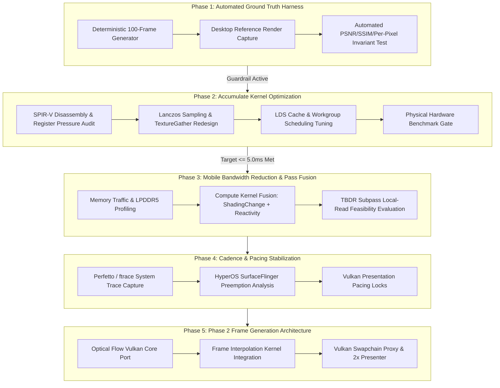

# Better FSR3 Android — Master Execution Plan
## From Working Prototype to Production-Grade Lightweight Mobile Upscaler & Frame Generation

> **Document Status**: Active Implementation Blueprint & Engineering Roadmap  
> **Target Silicon**: Qualcomm Snapdragon 8s Gen 3 (Adreno 735), Snapdragon 870 (Adreno 650), Arm Mali/Immortalis  
> **Core Directive**: Strict Invariant-Driven Architecture; Zero Speculative Hacks; Measure Before Optimizing  

---

## 1. Executive Context & Baseline State

The first four milestones established a functional 7-pass FSR 3.1.4 compute pipeline on Android Vulkan, validated with **11,602 passing assertions** and zero memory leaks. Controlled physical hardware telemetry revealed the actual execution landscape:

```
Total FSR 3.1.4 GPU Execution Time (1080p -> 4K / 1.5K):
- Adreno 650 (Mi 11X): 19.25 ms  [Accumulate = 14.11 ms | 73.3%]
- Adreno 735 (Poco F6): 8.59 ms   [Accumulate =  6.07 ms | 70.7%]
- Remaining 6 Passes:   2.52 ms   [PrepareInputs, Pyramids, Reactivity, Instability]
```

### The Root Engineering Problem
FSR 3.1.4 is not yet "lightweight" on mobile because **`Accumulate` consumes >70% of the entire frame budget**, and all 7 passes write intermediate surfaces out to external LPDDR5 DRAM.

To solve this systematically without introducing visual regressions, the engineering execution must proceed in five strictly ordered phases.

---

## 2. Master Execution Sequence



---

## 3. Phase-by-Phase Technical Specifications

### Phase 1: Automated Image Quality & Regression Verification Harness
**Objective**: Build an automated mathematical ground-truth verification harness before touching any shader math.  
**Rule**: *Passing unit tests does not prove correctness. Never optimize a shader without an automated visual invariant test.*

1. **Deterministic Multi-Frame Generator**:
   - Enhance `tests/test_milestone2.cpp` or build `tests/test_image_quality.exe`.
   - Render a continuous, reproducible sequence of **100 consecutive frames** with deterministic camera orbit, dynamic checkerboard geometry, and standard Halton `(2, 3)` sub-pixel jitter sequences.
   - Dump uncompressed 16-bit float / 32-bit RGBA raw image frames for all 100 steps.
2. **Desktop Reference Pipeline Comparison**:
   - Execute the identical 100-frame input sequence through official AMD FSR 3.1.4 reference code on host PC.
   - Compare mobile output against desktop reference output frame-by-frame.
3. **Mathematical Acceptance Invariants**:
   - **Mean SSIM**: $\ge 0.950$ across all 100 frames.
   - **Mean PSNR**: $\ge 32.0\text{ dB}$ across all 100 frames.
   - **Per-Pixel Absolute Error**: $\ge 99.0\%$ of output texels must satisfy $|I_{\text{mobile}} - I_{\text{ref}}| \le 2/255$ per channel (accounting for FP16 half-precision rounding drift).
   - **Zero Ghosting / Divergence**: Temporal history variance must remain bounded across all 100 frames without unbounded feedback explosion.

---

### Phase 2: `Accumulate` Kernel Mobile Dissection & ALU/Memory Tuning
**Objective**: Cut `Accumulate` execution time by **40% – 50%**, reducing total upscaler time on Adreno 735 from $8.59\text{ ms} \rightarrow \le 5.0\text{ ms}$.  
**Rationale**: `Accumulate` is 71% of total execution time. Shaving 40% off `Accumulate` saves $2.5\text{ ms}$ on Adreno 735 and $5.6\text{ ms}$ on Adreno 650.

1. **Instruction & Register Pressure Disassembly**:
   - Disassemble [`ffx_fsr3upscaler_accumulate_pass.glsl`](file:///C:/Users/aksha/Desktop/fsr3%20android/src/backends/vk/shaders/fsr3upscaler/ffx_fsr3upscaler_accumulate_pass.glsl) via `glslangValidator -V` and `spirv-dis`.
   - Measure Vector General Purpose Register (VGPR) allocation count. Adreno GPUs reduce active wave occupancy per compute unit when VGPR usage exceeds architecture thresholds (spilling to off-chip scratch memory).
2. **Lanczos Texture Fetch Redesign**:
   - The 12-tap Lanczos filter performs unrolled bilateral texture sampling (up to 36 dependent image lookups per pixel).
   - Evaluate `textureGather` to fetch $2 \times 2$ texel footprints in a single instruction rather than 4 separate bilinear samples.
   - Investigate Local Data Share (LDS / shared memory) caching: neighboring pixels in an $8 \times 8$ workgroup overlap 80% of their input texel neighborhood. Staging input texels into LDS eliminates redundant DRAM/L2 cache texture fetches.
3. **Threadgroup Dimension Optimization**:
   - Profile Wave32 vs Wave64 execution on Adreno 735.
   - Benchmark workgroup dimensions: $8 \times 8$ (64 threads = 2 Wave32s) vs $16 \times 4$ vs $8 \times 4$.
4. **Acceptance Invariants**:
   - Must maintain 100% pass on Phase 1 SSIM / PSNR criteria.
   - **Performance Target**:
     - Adreno 735: `Accumulate` $\le 3.50\text{ ms}$ (Total pipeline $\le 5.5\text{ ms}$).
     - Adreno 650: `Accumulate` $\le 8.50\text{ ms}$ (Total pipeline $\le 12.0\text{ ms}$).

---

### Phase 3: Mobile Bandwidth Reduction & Kernel Fusion
**Objective**: Eliminate redundant DRAM traffic between sequential compute passes.  
**Rationale**: Mobile SoCs share LPDDR5 bandwidth between CPU, GPU, and Display processor. Pure compute passes write intermediate textures to DRAM and read them back in the next pass.

1. **Pass Dependency & Fusion Audit**:
   - `ShadingChange` ($0.05\text{ ms}$) computes luminance delta and writes to an intermediate texture, which is immediately consumed by `PrepareReactivity` ($0.60\text{ ms}$).
   - Fuse `ShadingChange` directly into the `PrepareReactivity` compute shader, eliminating 1 dispatch, 1 barrier, and 1 intermediate DRAM read/write roundtrip.
2. **TBDR Subpass Feasibility Check**:
   - Evaluate Vulkan multi-subpass render passes with `VK_ATTACHMENT_STORE_OP_DONT_CARE` and `subpassLoad()` for passes operating at display resolution.
   - If full Vulkan subpass refactoring introduces backend complexity, compute-kernel fusion delivers 80% of the bandwidth benefit with zero backend vtable churn.
3. **Acceptance Invariants**:
   - Minimum $15\%$ reduction in external memory read/write bytes.
   - Zero change to output color precision.

---

### Phase 4: System Cadence & SurfaceFlinger Pacing Stabilization
**Objective**: Eliminate the frame cadence jitter and preemption spikes identified in `anomaly_analysis.json` on Xiaomi HyperOS.

1. **Perfetto / ftrace Kernel Trace Capture**:
   - Profile the POCO F6 during active upscaling using Android Perfetto with `gpu`, `kgsl`, `surfaceflinger`, and `sched` data sources enabled.
   - Identify whether the periodic $16\text{ ms}$ spikes are caused by SurfaceFlinger compositor preemption, thermal throttling step-downs, or dynamic GPU frequency scaling governor latency.
2. **Vulkan Pacing Invariants**:
   - Audit presentation queue synchronization (`samples/common/swapchain_sync.h`).
   - Implement frame pacing locks to prevent CPU submission from drifting more than 1 VSYNC ahead of GPU completion.
3. **Acceptance Invariants**:
   - P99 frame presentation jitter reduced to $< 2.0\text{ ms}$ variance under sustained 60 Hz / 120 Hz playback.

---

### Phase 5: Phase 2 Frame Generation Architecture
**Objective**: Port AMD FSR 3.1.4 Optical Flow and Frame Interpolation to mobile Vulkan to generate synthetic intermediate frames (60 FPS $\rightarrow$ 120 FPS).

1. **Optical Flow Core (`ffx_opticalflow`)**:
   - Port 2D dense optical flow vector pyramid calculation to `src/components/opticalflow/` using `FfxmInterface`.
   - Compile FP16 SPIR-V compute kernels with mobile LDS fallbacks.
2. **Frame Interpolation (`ffx_frameinterpolation`)**:
   - Implement interpolation pass blending optical flow vectors, game motion vectors, depth, and color history.
3. **Mobile Swapchain Proxy Presenter**:
   - Create Vulkan swapchain proxy intercepting `vkQueuePresentKHR` to inject the generated frame between real rendered frames at exact VSYNC cadence.
4. **Acceptance Invariants**:
   - Clean 2:1 presentation pacing (1 Real Frame : 1 Interpolated Frame).
   - Frame Generation compute overhead $\le 4.5\text{ ms}$ on Adreno 735.

---

## 4. Immediate Next Step & Decision Gate

The mandatory next step is **Phase 1: Automated Image Quality & Regression Verification Harness**:
- Create `tests/test_image_quality.cpp` to render and dump 100 deterministic frames.
- Establish the SSIM / PSNR automated gate so we can immediately begin tearing down the `Accumulate` kernel in Phase 2 with total mathematical safety.
